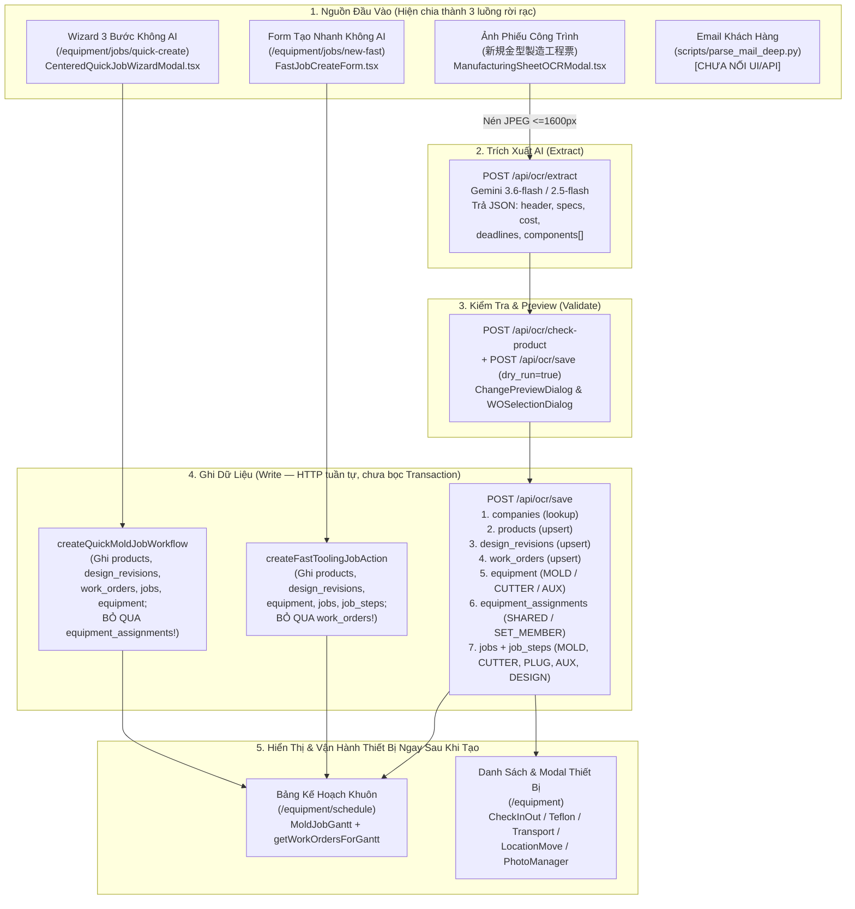

# Báo Cáo Kiểm Toán Toàn Diện: `WO-AI-EXTRACTION-AUDIT` (Gate 1 — Read-Only)

- **Ngày thực hiện:** `2026-10-17 18:18 JST`
- **Chỉ thị gốc:** PE Directive `65ffb9df` (`WO-AI-EXTRACTION-AUDIT` — Gate 1 Read-Only)
- **Phạm vi:** Rà soát toàn diện quy trình nhận yêu cầu làm khuôn mới (ảnh phiếu `新規金型製造工程票` / mail / form nhanh) $\rightarrow$ trích xuất AI $\rightarrow$ tạo mới/cập nhật 5 bảng cốt lõi (`products`, `design_revisions`, `work_orders`, `jobs`, `equipment` + `equipment_assignments` + `job_steps`) $\rightarrow$ kiểm toán dữ liệu thực tế trên Bảng Kế hoạch Khuôn (`/equipment/schedule`) $\rightarrow$ đối chiếu các module vận hành thiết bị ngay sau khi tạo giữa `MoldCutterSearch-github` và `ysdms-nextgen`.
- **Trạng thái DB Production:** `0` thay đổi (`100%` Read-Only).

---

## 1. Sơ Đồ Pipeline Hiện Tại Từ Đầu Vào Đến Hiển Thị (`ysdms-nextgen`)

### Phát Hiện Trọng Yếu Về Kiến Trúc Luồng Tạo Mới
1. **3 luồng tạo mới bị phân mảnh và lệch chuẩn Schema V3:**
   - **Luồng 1 (`ManufacturingSheetOCRModal` $\rightarrow$ `/api/ocr/save`):** Đầy đủ nhất (có trích xuất AI Gemini, kiểm tra trùng `check-product`, `dry_run` preview diff trước khi lưu, tạo đủ `products`, `design_revisions`, `work_orders`, `equipment`, `equipment_assignments`, `jobs`, `job_steps`), nhưng chạy bằng chuỗi lệnh Supabase REST tuần tự (**không nằm trong 1 DB Transaction** — nếu lỗi ở bước 6 hoặc 7 sẽ để lại bản ghi mồ côi ở bước 2–5).
   - **Luồng 2 (`FastJobCreateForm` $\rightarrow$ `createFastToolingJobAction`):** Gọi RPC `create_fast_tooling_job` (không tồn tại trong DB), sau đó fallback sang code client: **không tạo `work_orders`** (`jobs.work_order_id = NULL`) và truyền sai tên cột `product_lifecycle_status: 'ACTIVE'` (dòng `163` của [`fast-tooling-job.ts`](file:///d:/AntiGravity_Workspace/apps/ysdms-nextgen/src/app/actions/fast-tooling-job.ts#L163) thay vì `product_status: 'ACTIVE'`).
   - **Luồng 3 (`QuickJobWizard` $\rightarrow$ `createQuickMoldJobWorkflow`):** Luôn ép `revision_number = 1`, gán `design_category = 'MASS_PRODUCTION'` (trong khi `/api/ocr/save` dùng `'MASS'`), không tạo `equipment_assignments`, và hardcode fallback `companyId = '3c52ba34-...'`.
   - **Luồng 4 (Mail):** Hiện chỉ có script phân tích offline (`scripts/parse_mail_deep.py`), **chưa có tính năng dán nội dung Email / thả file đính kèm** trực tiếp vào `ManufacturingSheetOCRModal` để AI kết hợp thông tin từ cả Email lẫn ảnh phiếu công trình.

---

## 2. Bảng Đối Chiếu Trường Dữ Liệu Trên 5 Bảng Đích (`/api/ocr/save`)

| Bảng Đích | Các Trường Đã Gán Từ AI OCR (`/api/ocr/save`) | Các Trường Đang Thiếu / Lệch Nghiệp Vụ | Hệ Quả Thực Tế Trên Hệ Thống |
| :--- | :--- | :--- | :--- |
| **`public.products`** | `product_code`, `product_name_internal`, `product_name`, `product_description`, `customer_product_name`, `company_id`, `pocket_count`, `box_spec`, `first_shipment_date`, `product_status` (`ACTIVE`) | 1. **Lỗi nghiêm trọng khi lookup `company_id`** ([`save/route.ts:111-119`](file:///d:/AntiGravity_Workspace/apps/ysdms-nextgen/src/app/api/ocr/save/route.ts#L111-L119)): nếu AI không khớp được `customer_code_prefix` hoặc `customer_name`, code lấy **dòng đầu tiên bất kỳ trong bảng `companies`**! 2. Thiếu `drawing_no`, `customer_equipment_no`, `tray_weight_g`. | Sản phẩm mới có nguy cơ bị gán nhầm sang công ty đầu tiên trong DB nếu tên khách hàng trên phiếu viết tắt lạ. |
| **`public.design_revisions`** | `product_id`, `company_id`, `design_code`, `revision_number`, `design_category` (`MASS`), `status` (`RELEASED`), `cav_type_id`, `plastic_type_designed`, `plastic_id`, `design_length`, `design_width`, `design_height`, `design_depth`, `cutline_length`, `cutline_width`, `cavity_count`, `plug_type`, `has_separate_cutter`, `corner_r`, `chamfer_c`, `draft_angle`, `tolerance_pitch` | Thiếu `orientation` (Hướng xếp), `setup_type`, `under_depth`, `undercut_spec`, `text_content` (Chữ khắc trên khay), `drawing_file_url` (Lưu ảnh phiếu gốc đã upload lên Supabase Storage để đối chiếu lại). | Ảnh phiếu công trình sau khi OCR xong **không được lưu lại** vào Storage để xem lại từ hồ sơ Thiết kế / Khuôn. |
| **`public.work_orders`** | `wo_code` (`WO-YYYY-XXXXXX`), `wo_name`, `product_id`, `design_revision_id`, `company_id`, `wo_type` (`NEW_MOLD` / `MODIFICATION`), `wo_status` (`OPEN`), `start_date`, `deadline` | Thiếu `responsible_id` (AI đã trích xuất `designer_name` ở header nhưng `save/route.ts` chưa map sang `public.employees.employee_id`), `order_id`, `case_id`. | Trên Bảng Kế hoạch Khuôn, cột người phụ trách WO (`responsible_id`) bị trống. |
| **`public.equipment`** & **`equipment_assignments`** | `equipment_code`, `display_name`, `equipment_type` (`MOLD`, `CUTTER_SEPARATE`, `CUTTER_INLINE`, `WATER_BASE`, `FRAME`, `STACKING`, `PRESSURE_BASE`), `design_revision_id`, `cav_type_id`, `material_spec`, `actual_length_mm`, `actual_width_mm`, `actual_height_mm`, `cost_note`, `shared_with_code`, `shared_note`, `device_status` (`AVAILABLE`), `usage_status` (`ACTIVE`) | 1. **Sai ngữ nghĩa `equipment.company_id`** ([`save/route.ts:511,591,708`](file:///d:/AntiGravity_Workspace/apps/ysdms-nextgen/src/app/api/ocr/save/route.ts#L511)): đang gán `companyId` của **Khách hàng đặt khay** thay vì **Nhà cung cấp gia công khuôn (`MachiningCustomerID`)** theo chuẩn Wave 2 Decision 2.C. 2. **Bỏ sót thiết bị `PLUG`** ([`save/route.ts:676`](file:///d:/AntiGravity_Workspace/apps/ysdms-nextgen/src/app/api/ocr/save/route.ts#L676)): lọc `.filter(c => c.component_type !== 'PLUG')`, dẫn tới không tạo dòng `equipment` cho Plug và khiến `plugEquipId` ở dòng `1035` luôn bằng `NULL`! 3. Thiếu `current_rack_layer_id` (vị trí giá kệ dự kiến) và `keeper_company_id` (đơn vị đang giữ khuôn). | - Khuôn tạo từ OCR bị hiển thị tên Khách hàng ở trường Nhà gia công khuôn. - Thiết bị Plug không có hồ sơ trong bảng `equipment`, và Job gia công Plug (`PLG-*`) bị `equipment_id = NULL`. |
| **`public.jobs`** & **`public.job_steps`** | `job_code`, `job_name`, `equipment_id`, `job_status`, `job_type_id`, `job_category` (`MOLD_NEW`, `MOLD_MODIFY`, `CUTTER_NEW`, `EQUIPMENT_NEW`, `DESIGN`), `product_id`, `design_revision_id`, `company_id`, `work_order_id`, `ship_date`, `mold_deadline`, `target_completion_date`, `deadline`, `unit_price`, `price_quote_required`, `separate_cutter`, `has_plug` | 1. Step 7 ([`save/route.ts:1062-1122`](file:///d:/AntiGravity_Workspace/apps/ysdms-nextgen/src/app/api/ocr/save/route.ts#L1062-L1122)) tự sinh thêm 1 Job `DESIGN` (`DES-<code >`) có **`equipment_id = NULL`**. 2. Hàm `upsertEquipmentJob` quên gán `start_date` cho các Job `MOLD`/`CUTTER`/`PLUG`/`AUX` (chỉ Job `DESIGN` có `start_date`). 3. `job_steps` tạo mới không map `item_type_id` vào `public.item_types` và thiếu `track` cho các công đoạn phụ. | - Phát sinh Job `DES-JAE380` không gắn với `equipment_id`. - Các Job thiết bị mới thiếu `start_date` trên thanh Gantt. |

---

## 3. Kiểm Toán Dữ Liệu Thực Tế Trên "Bảng Kế Hoạch Khuôn" (`/equipment/schedule`)

Truy vấn trực tiếp trên Production DB (`NOW() = 2026-04-17 09:13:20+00`) đối với các bảng phục vụ `/equipment/schedule` (`getWorkOrders`, `getWorkOrdersForGantt`, `getJobsForGantt`):

### 3.1. Bảng Tổng Hợp Mật Độ Dữ Liệu & Các Cột Bị `NULL`

| Bảng | Tổng Số Dòng | Cột Kiểm Toán | Số Dòng `NULL` | Tỷ Lệ Thiếu | Tác Động Trực Tiếp Lên UI `/equipment/schedule` |
| :--- | ---: | :--- | ---: | ---: | :--- |
| **`public.work_orders`** | `1,230` | `product_id` | **`0`** | `0.0%` | `100%` liên kết chuẩn tới `products`. |
| **`public.work_orders`** | `1,230` | `design_revision_id` | **`0`** | `0.0%` | `100%` liên kết chuẩn tới `design_revisions`. |
| **`public.work_orders`** | `1,230` | `company_id` | **`1,131`** | **`92.0%`** | `getWorkOrdersForGantt` join `companies!work_orders_company_id_fkey`: **`1,131/1,230` WO bị trống tên công ty** trên bảng Gantt (dù `products.company_id` hoặc `equipment.company_id` đã có). |
| **`public.work_orders`** | `1,230` | `deadline` | **`1,202`** | **`97.7%`** | `getWorkOrders` lọc và sắp xếp theo `work_orders.deadline`: **`1,202/1,230` WO bị `deadline = NULL`**, trong khi bảng con `jobs.deadline` đã có dữ liệu trên `1,134` dòng! |
| **`public.work_orders`** | `1,230` | `start_date` | **`1,203`** | **`97.8%`** | `1,203` WO thiếu `start_date` (trong khi `jobs.start_date` đã có trên `799` dòng). |
| **`public.work_orders`** | `1,230` | `responsible_id` | **`1,203`** | **`97.8%`** | `1,203` WO thiếu người phụ trách. |
| **`public.jobs`** | `1,232` | `work_order_id` | **`1`** | `0.08%` | Chỉ 1 dòng nội bộ `JOB-INTERNAL-SHOP` (`380d3e19-6074-4701-a0bd-d0e8a2892202`). Toàn bộ `1,231` Job sản xuất đều có `work_order_id`. |
| **`public.jobs`** | `1,232` | `product_id` / `design_revision_id` | **`1`** | `0.08%` | Chỉ 1 dòng `JOB-INTERNAL-SHOP`. |
| **`public.jobs`** | `1,232` | `equipment_id` | **`2`** | `0.16%` | Chỉ 2 dòng: `JOB-INTERNAL-SHOP` và **`DES-JAE380`** (`c2c71352-00b8-45fc-8f07-9edf89bfe345`, sinh từ `/api/ocr/save` Step 7). Toàn bộ `1,230` `JOB-*` từ Access đều có `100%` `equipment_id`! |
| **`public.jobs`** | `1,232` | `company_id` | **`1,131`** | **`91.8%`** | Giống `work_orders.company_id`: `1,131` Job bị `company_id = NULL`. |
| **`public.jobs`** | `1,232` | `job_type_id` | **`28`** | `2.3%` | **`27` Job mới nạp từ Wave 2** (`JOB-518..1738`) + `1` `JOB-INTERNAL-SHOP` đang có `job_type_id = NULL` (`job_category = 'MOLD_MANUFACTURING'`). |
| **`public.jobs`** | `1,232` | `mold_deadline` | **`1,166`** | **`94.6%`** | **Lỗi hiển thị nghiêm trọng trên `/equipment/schedule`:** [`schedule/page.tsx:85`](file:///d:/AntiGravity_Workspace/apps/ysdms-nextgen/src/app/equipment/schedule/page.tsx#L85) tính KPI "Trễ hạn" dựa trên `j.mold_deadline`, và `getJobsForGantt` sort theo `mold_deadline` đầu tiên, nhưng **`1,166/1,232` dòng đang để hạn hoàn thành ở cột `jobs.deadline` (`1,134` dòng có dữ liệu) chứ không phải `mold_deadline`!** |
| **`public.jobs`** | `1,232` | `deadline` | **`98`** | `8.0%` | `98` dòng chưa có `deadline` (trong đó có `5` dòng `OPEN`: `JOB-1737`, `JOB-1738`, `JOB-518`, `JOB-519`, `JOB-INTERNAL-SHOP`). |
| **`public.job_steps`** | `2,512` | `track` | **`2,507`** | **`99.8%`** | **`2,507/2,512` công đoạn có `track = NULL`** (chỉ 5 dòng native có `track = 'MOLD'`). Các view Gantt chia làn theo `track` (`MOLD` / `CUTTER` / `PLUG` / `DESIGN`) sẽ không phân loại được `2,507` dòng lịch sử nếu không fallback hoặc backfill `track`. |
| **`public.job_steps`** | `2,512` | `item_type_id` | **`2,457`** | **`97.8%`** | `2,457` dòng nạp trước Wave 2 chưa gán `item_type_id` (55 dòng Wave 2 đã gán `100%`). |
| **`public.production_schedules`** | `30` | `mold_id` / `order_line_id` | **`30`** | **`100.0%`** | Bảng kế hoạch ép khay (`production_schedules`, `30` dòng demo/seed) đang có `100%` `mold_id = NULL` và `order_line_id = NULL`. |

### 3.2. Danh Sách Chi Tiết Các Job Đang `OPEN` / `IN_PROGRESS` Bị Thiếu Trường Cốt Lõi

| `job_code` | `job_id` | `job_status` | `job_category` | Các Trường Bị `NULL` Cần Xử Lý |
| :--- | :--- | :--- | :--- | :--- |
| **`DES-JAE380`** | `c2c71352-00b8-45fc-8f07-9edf89bfe345` | `IN_PROGRESS` | `DESIGN` | `equipment_id = NULL` (sinh từ `/api/ocr/save` Step 7), `mold_deadline = NULL`, `ship_date = NULL` |
| **`JOB-INTERNAL-SHOP`** | `380d3e19-6074-4701-a0bd-d0e8a2892202` | `OPEN` | `INTERNAL_OPS` | `work_order_id = NULL`, `product_id = NULL`, `design_revision_id = NULL`, `equipment_id = NULL`, `job_type_id = NULL` (Job nội bộ xưởng — cần lọc loại trừ khỏi Gantt Khuôn) |
| **`JOB-1738`** | `cf024eb5-9072-4a47-9341-04d54bf58f65` | `OPEN` | `MOLD_MANUFACTURING` | `job_type_id = NULL`, `start_date = NULL`, `deadline = NULL`, `mold_deadline = NULL` |
| **`JOB-1737`** | `102ac62e-f2fe-4d2a-8696-9e745bb28e64` | `OPEN` | `MOLD_MANUFACTURING` | `job_type_id = NULL`, `deadline = NULL`, `mold_deadline = NULL` |
| **`JOB-519`** | `24c587f8-9a5c-4146-9b56-08275645fc84` | `OPEN` | `MOLD_MANUFACTURING` | `company_id = NULL`, `job_type_id = NULL`, `start_date = NULL`, `deadline = NULL`, `mold_deadline = NULL` |
| **`JOB-518`** | `ba38f478-3f1d-4d0e-9400-3bfca448f362` | `OPEN` | `MOLD_MANUFACTURING` | `company_id = NULL`, `job_type_id = NULL`, `start_date = NULL`, `deadline = NULL`, `mold_deadline = NULL` |

---

## 4. Ma Trận So Sánh Vận Hành Thiết Bị: `MoldCutterSearch-github` vs `ysdms-nextgen`

Sau khi thiết bị (`equipment`) được tạo từ AI OCR hoặc đồng bộ từ Wave 1–3, người vận hành xưởng cần thao tác ngay trên thiết bị đó. Kết quả đối chiếu giữa repo tham chiếu `D:\AntiGravity_Workspace\apps\MoldCutterSearch-github` và `ysdms-nextgen` cho thấy **4 sự đứt gãy nghiêm trọng giữa UI `ysdms-nextgen` và các bảng SSOT vừa nạp ở Wave 3**:

| Nghiệp Vụ Vận Hành | Cách Làm Trong `MoldCutterSearch-github` | Thực Trạng Trong `ysdms-nextgen` (`src/app/equipment/_components/detail-modal/modules/`) | Chẩn Đoán Đứt Gãy & Khoảng Trống (Gap) |
| :--- | :--- | :--- | :--- |
| **1. Check-in / Check-out (Kiểm kê & Xuất/Nhập kho nhanh)** | [`checkin-checkout.js`](file:///d:/AntiGravity_Workspace/apps/MoldCutterSearch-github/checkin-checkout.js) (`2,444` dòng): - 2 chế độ: **Stamp** (1 chạm đóng dấu kiểm kê tại chỗ) & **Smart** (tự gợi ý IN/OUT theo trạng thái cuối). - Ghi đồng bộ vào `statuslogs` (`/api/checklog`), có chọn nhân viên Ghim cố định, chọn đích đến, tự đóng modal sau 1s. | [`CheckInOutModule.tsx`](file:///d:/AntiGravity_Workspace/apps/ysdms-nextgen/src/app/equipment/_components/detail-modal/modules/CheckInOutModule.tsx): - Chỉ đọc/ghi bảng `equipment_history` với `.in('action_type', ['IN', 'OUT', 'CHECK_IN', 'CHECK_OUT'])`. - Không có chế độ Stamp kiểm kê (`AUDIT`). | **ĐỨT GÃY SỐ 1:** - Wave 3 vừa nạp **`352` dòng** lịch sử từ `tblStatusLog` vào **`public.equipment_status_logs`** và `equipment_history` với `action_type IN ('STATUS_CHECK_IN', 'STATUS_CHECK_OUT', 'STATUS_AUDIT')`. - Do `CheckInOutModule.tsx` không lọc `STATUS_*` và không đọc/ghi `equipment_status_logs`, **toàn bộ `352` dòng lịch sử Check-in/out thực tế không hiển thị trên UI!** |
| **2. Mạ Teflon (`Teflon Coating`)** | [`teflon-processing.js`](file:///d:/AntiGravity_Workspace/apps/MoldCutterSearch-github/teflon-processing.js) (`1,630` dòng) & [`global-teflon-module.js`](file:///d:/AntiGravity_Workspace/apps/MoldCutterSearch-github/global-teflon-module.js): - Quy trình 4 bước: `Yêu cầu mạ` $\rightarrow$ `Duyệt` $\rightarrow$ `Gửi đi mạ` $\rightarrow$ `Nhận khuôn về`. - Ghi `teflonlog` + tự động ghi `statuslogs` & `shiplog`. | [`TeflonCoatingModule.tsx`](file:///d:/AntiGravity_Workspace/apps/ysdms-nextgen/src/app/equipment/_components/detail-modal/modules/TeflonCoatingModule.tsx): - Đang truy vấn và insert vào bảng **`public.jobs`** với `.eq('job_category', 'EQUIPMENT_REPAIR')` (**`0` dòng** trong DB)! | **ĐỨT GÃY SỐ 2 (NGHIÊM TRỌNG NHẤT):** - Wave 3 vừa nạp **`190` dòng** lịch sử mạ Teflon từ `tblTeflonLog` vào bảng chuẩn **`public.mold_maintenance`** (`maintenance_type = 'TEFLON_COATING'`, `physical_mold_id = equipment_id`). - Vì `TeflonCoatingModule.tsx` đọc bảng `jobs` (`EQUIPMENT_REPAIR`), **cả `190` dòng lịch sử mạ Teflon trên Production đều không hiển thị trên tab Teflon của khuôn!** |
| **3. Vận Chuyển / Chuyển Công Ty (`Transport / ShipLog`)** | [`transfer-location-module.js`](file:///d:/AntiGravity_Workspace/apps/MoldCutterSearch-github/transfer-location-module.js) (`683` dòng): - Chuyển `FromCompanyID` $\rightarrow$ `ToCompanyID` qua `/api/add-shiplog`. - Áp dụng **Golden Rule**: nếu chuyển từ YSD (`ID=2`) ra ngoài thì tự động chuyển trạng thái sang `OUT`; nếu về YSD thì tự nhắc gán lại Giá-Tầng (`RackLayer`). | [`TransportModule.tsx`](file:///d:/AntiGravity_Workspace/apps/ysdms-nextgen/src/app/equipment/_components/detail-modal/modules/TransportModule.tsx): - Chỉ đọc/ghi `equipment_history` với `.eq('action_type', 'TRANSFER')` (**`0` dòng** từ Wave 3 vì Wave 3 ghi `SHIP_OUT` / `SHIP_IN` / `SHIP_TRANSFER`) và **không đọc/ghi `public.equipment_ship_logs`**! | **ĐỨT GÃY SỐ 3:** - Wave 3 vừa nạp **`356` dòng** vào **`public.equipment_ship_logs`** và `equipment_history` (`SHIP_OUT`, `SHIP_IN`, `SHIP_TRANSFER`). - `TransportModule.tsx` chỉ lọc `action_type = 'TRANSFER'` nên **không hiển thị bất kỳ dòng nào trong `356` lịch sử vận chuyển của Wave 3**, đồng thời khi tạo lệnh vận chuyển mới cũng không ghi vào `equipment_ship_logs`! |
| **4. Đổi Vị Trí Giá-Tầng (`Location Move`)** | [`location-move.js`](file:///d:/AntiGravity_Workspace/apps/MoldCutterSearch-github/location-move.js) (`441` dòng): - Chọn nhanh Giá (`Rack`) $\rightarrow$ Tầng (`RackLayer`), ghi `locationlog` + cập nhật `molds.RackLayerID`. | [`LocationMoveModule.tsx`](file:///d:/AntiGravity_Workspace/apps/ysdms-nextgen/src/app/equipment/_components/detail-modal/modules/LocationMoveModule.tsx): - Chỉ đọc `equipment_history` với `.eq('action_type', 'RELOCATE')` (**`0` dòng**). | **ĐỨT GÃY SỐ 4:** - Wave 3 vừa nạp **`1,488` dòng** đổi vị trí vào `equipment_history` với `action_type = 'LOCATION_CHANGE'` (và DB có sẵn `1,450` dòng trong `asset_location_logs`). - Do `LocationMoveModule.tsx` chỉ lọc `.eq('action_type', 'RELOCATE')`, **toàn bộ `1,488` dòng lịch sử đổi giá kệ của Wave 3 bị ẩn hoàn toàn trên UI!** |
| **5. Chụp & Quản Lý Ảnh Thiết Bị (`Photo Manager`)** | [`photo-upload.js`](file:///d:/AntiGravity_Workspace/apps/MoldCutterSearch-github/photo-upload.js) (`2,872` dòng) & [`device-photo-store.js`](file:///d:/AntiGravity_Workspace/apps/MoldCutterSearch-github/device-photo-store.js): - Chụp trực tiếp từ Camera điện thoại/tablet tại xưởng, tự nén ảnh, chọn làm ảnh đại diện (`is_thumbnail`), gửi ảnh báo cáo qua mail. | [`PhotoManagerModule.tsx`](file:///d:/AntiGravity_Workspace/apps/ysdms-nextgen/src/app/equipment/_components/detail-modal/modules/PhotoManagerModule.tsx) & [`EquipmentPhotoGallery.tsx`](file:///d:/AntiGravity_Workspace/apps/ysdms-nextgen/src/components/equipment/EquipmentPhotoGallery.tsx): - Lưu vào `public.equipment_photos` (hiện đang có `0` dòng) + bucket `equipment-photos`. | **KHOẢNG TRỐNG SỐ 5 (UI & Quy tắc Bảo mật):** 1. Chưa áp dụng **Privacy Blur Shield mặc định** (`blur filter` + `:hover` / nút `Toggle Blur`) theo **Quy tắc Toàn cục số 3 (Media Privacy & Blur Shield)**. 2. Chưa có nút mở trực tiếp Camera thiết bị (`capture="environment"`) để công nhân chụp ảnh khuôn mới về xưởng chỉ bằng 1 chạm. 3. Ảnh phiếu công trình lúc OCR (`/api/ocr/extract`) chưa được tự động lưu thành tài liệu/ảnh đính kèm của Khuôn/Thiết kế. |
| **6. Ghi Nhật Ký Công Việc (`Worklog`) Ngay Sau Khi Tạo Khuôn** | Ghi trực tiếp vào `worklog` theo mã khuôn. | Ghi vào `public.worklogs` thông qua `job_id` / `job_step_id` (`/worklogs`). | Với các khuôn tạo từ `FastJobCreateForm` (không tạo `work_orders`) hoặc thiết bị `PLUG` tạo từ `/api/ocr/save` (`equipment_id = NULL`), việc truy vết ngược từ Worklog về Thiết bị/WO bị đứt mạch. |

---

## 5. Đề Xuất Lộ Trình Cải Tiến Cụ Thể (Chia Theo Các Work Order Gọn Rõ Để PE Phê Duyệt)

Để giải quyết triệt để các điểm đứt gãy trên mà không làm phình phạm vi trong một lần sửa, AN đề xuất PE chia thành **3 Work Order kế tiếp** theo thứ tự ưu tiên nghiệp vụ:

### Đề Xuất 1: `WO-EQUIP-OPS-WAVE3-WIRING` (Ưu Tiên Cao Nhất — Khai Thông Ngay `2,386` Dòng Lịch Sử Wave 3 Lên UI)
- **Mục tiêu:** Nối 4 module vận hành trong Modal Chi Tiết Thiết Bị (`src/app/equipment/_components/detail-modal/modules/`) vào đúng các bảng và mã `action_type` chuẩn của Wave 3 + bổ sung Privacy Blur Shield cho ảnh thiết bị:
  1. [`TeflonCoatingModule.tsx`](file:///d:/AntiGravity_Workspace/apps/ysdms-nextgen/src/app/equipment/_components/detail-modal/modules/TeflonCoatingModule.tsx): Chuyển từ bảng `jobs` (`EQUIPMENT_REPAIR`) sang đọc/ghi trực tiếp **`public.mold_maintenance`** (`physical_mold_id = equipment.equipment_id`, `maintenance_type = 'TEFLON_COATING'`) + ghi log đối ứng vào `equipment_history`. Ngay lập tức hiển thị **`190` dòng** lịch sử mạ Teflon của Wave 3.
  2. [`TransportModule.tsx`](file:///d:/AntiGravity_Workspace/apps/ysdms-nextgen/src/app/equipment/_components/detail-modal/modules/TransportModule.tsx): Đọc kết hợp **`public.equipment_ship_logs`** (`356` dòng Wave 3) và `equipment_history` (`action_type IN ('TRANSFER', 'SHIP_OUT', 'SHIP_IN', 'SHIP_TRANSFER')`); khi tạo lệnh vận chuyển mới thì ghi đồng thời vào cả `equipment_ship_logs` lẫn `equipment_history` và áp dụng Golden Rule cập nhật `keeper_company_id` / `device_status`.
  3. [`LocationMoveModule.tsx`](file:///d:/AntiGravity_Workspace/apps/ysdms-nextgen/src/app/equipment/_components/detail-modal/modules/LocationMoveModule.tsx): Mở rộng bộ lọc `equipment_history` sang `.in('action_type', ['RELOCATE', 'LOCATION_CHANGE'])` để hiển thị ngay **`1,488` dòng** lịch sử đổi giá kệ của Wave 3.
  4. [`CheckInOutModule.tsx`](file:///d:/AntiGravity_Workspace/apps/ysdms-nextgen/src/app/equipment/_components/detail-modal/modules/CheckInOutModule.tsx): Mở rộng bộ lọc `equipment_history` sang `.in('action_type', ['IN', 'OUT', 'CHECK_IN', 'CHECK_OUT', 'STATUS_CHECK_IN', 'STATUS_CHECK_OUT', 'STATUS_AUDIT'])` và đồng bộ ghi vào **`public.equipment_status_logs`** + thêm nút **Stamp Kiểm kê (`AUDIT`)** 1 chạm như `MoldCutterSearch`.
  5. [`EquipmentPhotoGallery.tsx`](file:///d:/AntiGravity_Workspace/apps/ysdms-nextgen/src/components/equipment/EquipmentPhotoGallery.tsx) & [`ManufacturingSheetOCRModal.tsx`](file:///d:/AntiGravity_Workspace/apps/ysdms-nextgen/src/components/ocr/ManufacturingSheetOCRModal.tsx): Áp dụng **Privacy Blur Shield mặc định** (blur + hover/toggle blur theo Rule 3 Global) và thêm hỗ trợ chụp ảnh trực tiếp từ camera (`capture="environment"`).

### Đề Xuất 2: `WO-SCHEDULE-DATA-AND-UI-ALIGNMENT` (Chuẩn Hóa Bảng Kế Hoạch Khuôn `/equipment/schedule`)
- **Mục tiêu:** Khắc phục tình trạng `1,131` dòng trống tên công ty, `1,202` WO trống `deadline`, `1,166` Job trống `mold_deadline`, và `2,507` `job_steps` trống `track`:
  1. **Code UI/Query (`/equipment/schedule` & `src/app/actions/mold-job.ts`, `work-orders.ts`):**
     - Sửa logic tính hạn & sắp xếp trên `/equipment/schedule`: dùng `COALESCE(mold_deadline, deadline)` thay vì chỉ đọc `mold_deadline` (hiện `NULL` trên `1,166/1,232` dòng).
     - Loại trừ `job_category = 'INTERNAL_OPS'` (`JOB-INTERNAL-SHOP`) khỏi bảng Gantt chế tạo khuôn.
     - Fallback hiển thị tên công ty từ `products.company_id` / `equipment.company_id` khi `work_orders.company_id` bằng `NULL`.
  2. **Backfill DB (2 cổng PE — Dry-run $\rightarrow$ Thực thi):**
     - Đồng bộ `work_orders.deadline` và `work_orders.start_date` từ `jobs.deadline` / `jobs.start_date` cho `1,134` WO lịch sử.
     - Đồng bộ `work_orders.company_id` và `jobs.company_id` từ `equipment.company_id` / `products.company_id` cho các dòng còn `NULL`.
     - Điền `job_steps.track = 'MOLD'` (hoặc `'CUTTER'` theo `equipment.equipment_type`) cho `2,507` dòng `job_steps` đang có `track = NULL` và gán `job_type_id` cho `27` Job của Wave 2.

### Đề Xuất 3: `WO-AI-OCR-PIPELINE-HARDENING` (Chuẩn Hóa Luồng Trích Xuất AI & Hợp Nhất Form Tạo Mới)
- **Mục tiêu:** Sửa triệt để các lỗi logic trong `/api/ocr/save` và hợp nhất 3 luồng tạo mới:
  1. **Sửa 5 lỗi trong `/api/ocr/save/route.ts`:**
     - **Bỏ fallback nguy hiểm lấy công ty đầu tiên bất kỳ** (dòng `111–119`): nếu chưa khớp được công ty khách hàng trong DB, yêu cầu người dùng chọn từ Dropdown `companies` trên modal OCR (hoặc tạo công ty mới rõ ràng).
     - **Tách rõ `customer_company_id` (Khách hàng đặt khay $\rightarrow$ `products.company_id`) và `machining_vendor_id` (Nhà gia công khuôn $\rightarrow$ `equipment.company_id`, `work_orders.company_id`, `jobs.company_id`)** theo đúng chuẩn Wave 2 Decision 2.C.
     - **Tạo đầy đủ bản ghi `public.equipment` cho `PLUG`** (`equipment_type = 'PLUG'`) và liên kết vào `equipment_assignments` (`SET_MEMBER`) + gán `equipment_id` cho Job `PLG-*`.
     - **Gắn `equipment_id = moldEquipmentId` cho Job `DESIGN` (`DES-*`)** (bao gồm cập nhật luôn dòng `DES-JAE380` hiện có) và bổ sung `start_date` cho toàn bộ Job thiết bị trong `upsertEquipmentJob`.
     - **Tự động lưu ảnh phiếu công trình (`新規金型製造工程票`)** vừa quét OCR vào `public.equipment_photos` (kèm Privacy Blur Shield) để kỹ sư xem lại phiếu gốc ngay trong Modal Thiết bị.
  2. **Bổ sung chế độ "Dán nội dung Email + Ảnh phiếu" trong `ManufacturingSheetOCRModal`:** Cho phép gửi kèm văn bản email của khách hàng cùng ảnh phiếu công trình vào `/api/ocr/extract` để AI đối chiếu chéo số lượng, ngày giao hàng và yêu cầu đặc biệt.
  3. **Sửa lỗi `FastJobCreateForm` (`fast-tooling-job.ts`):** Sửa `product_lifecycle_status` $\rightarrow$ `product_status: 'ACTIVE'` và tự động tạo `work_orders` để không sinh Job mồ côi.
