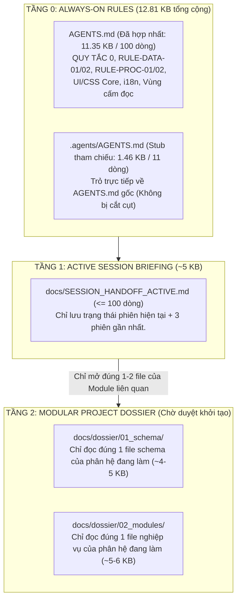

# 🗂️ BỘ HỒ SƠ KIỂM TOÁN TOÀN DIỆN & TÁI CẤU TRÚC KẾ HOẠCH DỰ ÁN YSDMS NEXTGEN (MODULAR DOSSIER v2.0)

- **Mã bộ hồ sơ:** `YSDMS-MASTER-PLAN-V2-20261014`
- **Ngày ban hành:** `2026-10-14 JST`
- **Mô hình thực thi:** **Gemini 4 Argon (High)** — Kỹ sư AN (Antigravity)
- **Hệ thống điều phối:** **YSDMS Realtime Bridge v2.5.0 (Unified Gold Edition)** — Cổng `3856`
- **Đệ trình:** Minh Chủ **THOAN** (Product Owner / Gatekeeper) & Kiến trúc sư trưởng **PE** (Perplexity Pro — Claude Sonnet Thinking)

---

## I. TRIẾT LÝ TỔ CHỨC HỒ SƠ PHÂN TÁCH THEO MODULE (THEO CHỈ THỊ CỦA MINH CHỦ THOAN)

Thực hiện chỉ thị trực tiếp của **Minh Chủ THOAN**:
> *"Xây dựng lại hồ sơ dự án theo hướng lưu riêng trong một folder, không lưu vào toàn bộ một file riêng, tránh việc chỉnh sửa sau này sẽ khó, tốn token mà nên bóc tách thành từng module nhỏ, mỗi module sẽ là một file riêng. Như vậy nếu sửa đổi kế hoạch liên quan đến nội dung nào thì sẽ đọc file đó, tránh phải đọc toàn bộ nội dung không cần thiết."*

Bộ hồ sơ kiểm toán và kế hoạch tổng thể mới (`docs/master_plan_v2/`) được thiết kế theo kiến trúc **1 File Chỉ Mục Nhẹ (`00_INDEX`) + Các File Chuyên Đề Độc Lập (`01` $\rightarrow$ `04`)**:

| Mã File | Đường dẫn | Nội dung cốt lõi | Khi nào AI / Dev cần đọc? |
| :--- | :--- | :--- | :--- |
| **`00_INDEX`** | `docs/master_plan_v2/00_INDEX_AND_MODULAR_ARCHITECTURE.md` | Chỉ mục điều hướng + **Kiểm toán Tối ưu hóa Bộ Quy tắc AI & Token Economy** | Đọc đầu tiên khi bắt đầu phiên mới (~3 KB) |
| **`01_MODEL`** | `docs/master_plan_v2/01_GEMINI4_ARGON_BENCHMARK_AND_BRIDGE_V2.5.md` | Đánh giá mô hình **Gemini 4 Argon**, so sánh đối chuẩn & Giao thức phối hợp AN-PE qua Bridge v2.5.0 | Khi cấu hình luồng điều phối AN-PE hoặc chuyển đổi model |
| **`02_BIZ_FLOW`** | `docs/master_plan_v2/02_REAL_BUSINESS_FLOW_AND_MOLD_DEPT_SYNTHESIS.md` | Tổng hợp luồng nghiệp vụ thực tế từ 10,427 email (`toanysdmail`) & Chuyên sâu Phòng Khuôn / Thiết bị | Khi thiết kế nghiệp vụ Kinh doanh, Báo giá, Thiết kế, Phòng Khuôn, Định hình |
| **`03_AUDIT_3D`** | `docs/master_plan_v2/03_THREE_WAY_AUDIT_GAPS_AND_CODEBASE_ISSUES.md` | Đối chiếu 3 chiều (Nghiệp vụ thực tế $\leftrightarrow$ Kế hoạch cũ $\leftrightarrow$ Schema & Codebase/UI hiện tại) kèm `file:line` | Khi sửa lỗi đứt gãy luồng, dọn dẹp route trùng lặp hoặc bảng deprecated |
| **`04_ROADMAP`** | `docs/master_plan_v2/04_REWRITE_ROADMAP_AND_MODULE_OUTLINE.md` | Đề cương chi tiết cấu trúc thư mục Hồ sơ Dự án Modular (`docs/dossier/`) & Lộ trình các Sprint tiếp theo | Khi lập kế hoạch Work Order mới hoặc cập nhật tiến độ từng phân hệ |

---

## II. KIỂM TOÁN BỘ QUY TẮC HIỆN TẠI CỦA DỰ ÁN & BÀI TOÁN TỐI ƯU TOKEN ECONOMY

### 1. Thực trạng định lượng các file Quy tắc & Ngữ cảnh đang nạp vào AI Agent
Qua đo đạc trực tiếp trên ổ cứng dự án (`d:\AntiGravity_Workspace\apps\ysdms-nextgen`), mỗi khi khởi động phiên mới theo quy định cũ, AI Agent bị buộc phải đọc khối lượng văn bản khổng lồ sau:

| STT | File Quy tắc / Sổ cái / Schema | Số dòng | Dung lượng | Vấn đề tồn tại (kèm dẫn chứng `file:line`) |
| :---: | :--- | ---: | ---: | :--- |
| 1 | `AGENTS.md` (Root) | 326 dòng | **20.7 KB** | Tự động nạp vào `<user_rules>`. Chứa quy tắc Routing, Page Anatomy, `RULE-DATA-01`, `RULE-DATA-02`, `RULE-PROC-01`, `RULE-PROC-02`, CSS, i18n. |
| 2 | `.agents/AGENTS.md` | 528 dòng | **30.0 KB** | Tự động nạp vào `<user_rules>`, nhưng **bị hệ thống cắt cụt (truncated mất 6,714 bytes cuối)** từ dòng 385 trở đi do vượt ngưỡng! Lặp lại tới **65% nội dung** đã có trong `AGENTS.md` (CSS, i18n, `RULE-PROC-01`, `RULE-PROC-02`, Table Sorting). Đồng thời dòng 379–401 vẫn vẽ sơ đồ cấu trúc cũ dùng `mold_masters`, `physical_molds`, `cutters`! |
| 3 | `AI_SYSTEM_RULES.md` | 241 dòng | **17.0 KB** | Lặp lại quy tắc Pagination, Server-side search, CSS variables, Typography và `RULE-UI-10` (Paper Style) đã nằm trong `AGENTS.md`. |
| 4 | `SCHEMA_REFERENCE.md` | 875 dòng | **46.6 KB** | Quá lớn cho 1 lần đọc. Nguy hiểm hơn: do nối đuôi (append) qua nhiều milestone nên **cùng một bảng bị định nghĩa lặp lại 2 lần với schema mâu thuẫn nhau**: • Bảng `equipment_loans` xuất hiện ở dòng `280-320` (`loan_type = 'BORROW' \| 'RETURN' \| 'REPAIR_OUT'`) VÀ lặp lại ở dòng `738-785` (`loan_type = 'CUSTOMER_LOAN' \| 'RETURN_TO_CUSTOMER' \| 'OUTSOURCE_PROCESSING'`). • Bảng `orders` & `order_lines` xuất hiện ở dòng `479-520` VÀ lặp lại ở dòng `542-574`. • Bảng `shipments` xuất hiện ở dòng `575-596` (`shipment_type = 'STANDARD' \| 'DIRECT' \| 'SAMPLE'`) VÀ lặp lại ở dòng `818-842` (`shipment_type = 'physical' \| 'service' \| 'mixed'`). |
| 5 | `ysdms-nextgen_MASTER.md` | 1,307 dòng | **149.7 KB** | Sổ cái tích lũy toàn bộ lịch sử từ đầu dự án. Nếu đọc trực tiếp sẽ ngốn ~40,000 tokens và làm loãng hoàn toàn sự chú ý (attention dilution) của mô hình. |
| 6 | `SESSION_HANDOFF.md` (Mempalace) | 845 dòng | **90.4 KB** | Do quy tắc "chỉ APPEND, không ghi đè", file bàn giao phiên đã phình lên 90.4 KB (chứa hàng chục phiên cũ từ tháng 8–9/2026), mất tác dụng của một bản "Briefing ngắn gọn đầu phiên". |
| **TỔNG** | **6 File Khởi động** | **4,122 dòng** | **354.4 KB** | **Tiêu tốn ~95,000 – 110,000 tokens ngay từ lượt đầu tiên, gây cắt cụt prompt và nhiễu loạn kiến trúc!** |

---

### 2. Năm (05) Điểm Bất Cập Trong Bộ Quy Tắc Hiện Tại Gây Rối Cho Các Mô Hình AI
1. **Trùng lặp chồng chéo giữa 3 file quy tắc (`AGENTS.md`, `.agents/AGENTS.md`, `AI_SYSTEM_RULES.md`):**
   - Cả hai file `AGENTS.md` và `.agents/AGENTS.md` đều được IDE tự động bơm vào `<user_rules>` mỗi lượt chat. Việc lặp lại các khối văn bản dài (`RULE-PROC-01`, `RULE-PROC-02`, CSS, Table Sorting, i18n) làm tốn gấp đôi context window thường trực và khiến cuối file `.agents/AGENTS.md` bị `<truncated 6714 bytes>`.
2. **Mâu thuẫn nội tại ngay trong file quy tắc và file kiến thức (`Knowledge Conflict`):**
   - `.agents/AGENTS.md:384-392` vẫn ghi sơ đồ: `/master/molds ← bảng mold_masters`, `/equipment/molds ← bảng physical_molds`, `/equipment/cutting-dies ← bảng cutters`, ngay bên dưới mục cấm dùng các bảng này (`dòng 210-235`).
   - `.agents/mempalace/knowledge/mold_manufacturing_process.md:64-65` ghi thông số bắt buộc của `products` là `external_length_mm, external_width_mm, primary_plastic_code` — trái ngược hoàn toàn với `RULE-DATA-02` trong `AGENTS.md:173-175`.
   - `.agents/mempalace/knowledge/thermoforming_equipment_set.md:50, 82-104` vẫn hướng dẫn dùng bảng `auxiliary_equipments` (bảng này vẫn **TỒN TẠI** trong `information_schema.tables`, nhưng theo `ADR-001`, `ADR-004` và `SCHEMA_REFERENCE.md:872-873` thiết bị chuẩn đã hợp nhất về `equipment` + `equipment_assignments`) và gán `jobs.physical_mold_id` (bảng `physical_molds` **KHÔNG TỒN TẠI** trong DB).
   - `.agents/mempalace/knowledge/business_rules.md:8` ghi trạng thái đơn hàng là `NEW → APPROVED → IN_PRODUCTION → SHIPPED → COMPLETED` — lệch với `SCHEMA_REFERENCE.md:488` (`DRAFT → CONFIRMED → IN_PRODUCTION → SHIPPED → CLOSED | CANCELLED`).
3. **File `SCHEMA_REFERENCE.md` (47,748 bytes = 46.63 KiB / 47.75 KB) vừa dài vừa tự mâu thuẫn do nối đuôi lịch sử:**
   - Khi làm việc ở phân hệ Báo giá (`quotations`), AI không cần đọc cấu trúc kho cuộn nhựa (`plastic_receipt_roll`) hay lịch nghỉ lễ (`company_calendar`), nhưng hiện tại phải đọc hoặc tìm kiếm trong một file 875 dòng có nhiều định nghĩa bảng bị trùng lặp, đồng thời thiếu bảng `profiles` (vốn đang **TỒN TẠI** thực tế trong DB).
4. **Cơ chế "Append-only" vào `SESSION_HANDOFF.md` (92,617 bytes = 90.45 KiB / 92.62 KB) và `ysdms-nextgen_MASTER.md` (153,306 bytes = 149.71 KiB / 153.31 KB):**
   - Khi một file handoff vượt quá 10 KB, nó trở thành kho lưu trữ lịch sử (archive) chứ không còn là "Active Context".

---

### 3. Đề Xuất Kiến Trúc Quy Tắc & Ngữ Cảnh Tối Ưu Mới (Tiered Context Architecture)

Để mô hình có ngữ cảnh trọng tâm:
- **Phép tính dung lượng cụ thể:** Tổng 6 file khởi động cũ là `21.18 + 30.71 + 17.37 + 47.75 + 153.31 + 92.62 = 362.94 KB` (`354.44 KiB`). Khi áp dụng cấu trúc phân tầng: Tầng 0 (`AGENTS.md` hợp nhất `11.35 KB` + `.agents/AGENTS.md` stub `1.46 KB` = `12.81 KB`) + Tầng 1 (`~5.00 KB`) + Tầng 2 (`2 file module ~10.00 KB`) = **`27.81 KB`** (giảm `335.13 KB`, tương đương giảm `92.34%` dung lượng văn bản cần nạp mỗi phiên).

---

## III. KẾT QUẢ XÁC MINH SCHEMA THỰC TẾ (`information_schema`) & ĐỐI SOÁT PHƯƠNG ÁN C

1. **Danh sách bảng đã xác minh trực tiếp qua `information_schema.tables` (`table_schema = 'public'` trên Supabase Production `iirezrszalmecsslbruo`):**
   - **TỒN TẠI (`EXISTS`):** `profiles`, `employees`, `auxiliary_equipments`, `mold_design_cutters`, `mold_work_orders`, `equipment`, `equipment_assignments`, `orders`, `order_lines`, `products`, `staging_order_lines_backfill`.
   - **KHÔNG TỒN TẠI (`NOT_FOUND`):** `mold_masters`, `physical_molds`, `cutters`, `order_items`, `product_master`.
   - *Lưu ý quan trọng:* Tuyệt đối không dùng nhận định cũ *"bảng `profiles` không tồn tại"* (bảng `profiles` có tồn tại thực tế trong DB dù `SCHEMA_REFERENCE.md` không liệt kê).
2. **Cơ chế Join & Đối soát chuẩn của Phương án C (`staging_order_lines_backfill` $\leftrightarrow$ `order_lines`):**
   - Bảng `public.staging_order_lines_backfill` gồm 15 cột: `staging_id, batch_no, source_row_no, order_no, line_no, product_id, product_code, product_code_source, quantity, quantity_source, quantity_normalized, notes, validation_status, validation_error, created_at`.
   - **Cột `resolved_order_id` (hay `order_id`) KHÔNG tồn tại trong `staging_order_lines_backfill`.**
   - **Cơ chế join chuẩn xác:**
     1. Kết nối `staging_order_lines_backfill.order_no = orders.order_no`.
     2. Sau đó dùng khóa chính `orders.order_id` để đối chiếu với `order_lines.order_id` (kết hợp `line_no`, `product_id`, `quantity`).
   - **Kết quả đối soát chỉ-đọc (đã được PE xác minh độc lập lúc `2026-10-14 10:34:30 JST`):** `staging_order_lines_backfill = 6,279` dòng; `order_lines = 6,279` dòng; `orders = 2,396`; `products = 8,489`; khớp `6,279 / 6,279` dòng theo `(order_id, line_no, product_id, quantity)`; `0` trùng lặp; `0` thiếu FK; `0` khoảng trống `line_no`; `PENDING = 6,277`, `NORMALIZED = 2`.

