# 🏭 NHIỆM VỤ 2: TỔNG HỢP TOÀN DIỆN LUỒNG NGHIỆP VỤ THỰC TẾ TẠI NHÀ MÁY YSD (TỪ 10,427 EMAIL & PHÒNG KHUÔN / THIẾT BỊ)

- **Mã tài liệu:** `YSDMS-MPV2-02-REAL-BUSINESS-FLOW`
- **Ngày lập:** `2026-10-14 JST`
- **Nguồn đối chiếu chính (SSOT):**
  - `docs/mail_analysis/00_BUSINESS_INSIGHTS.md` & `docs/mail_analysis/01_COMPREHENSIVE_BUSINESS_PROCESS_PROFILE.md`
  - `docs/business/MOLD_CUSTODY_BUSINESS_SPEC.md`
  - `.agents/mempalace/knowledge/mold_manufacturing_process.md`, `thermoforming_equipment_set.md`, `architecture_work_order_model_v1.md`, `business_rules.md`
  - `docs/quotations/01_MOLD_PRICING_STANDARD.md` & `docs/quotations/02_TRAY_PRICING_CALCULATION_FORMULA.md`
  - `docs/technical/07_equipment_matching_and_naming_rules.md`

---

## I. BỨC TRANH TỔNG THỂ: BẢN CHẤT NGHIỆP VỤ THỰC TẾ CỦA YOSHIDA PACKAGE (YSD)

Qua phân tích 10,427 luồng email giao dịch thực tế (`toanysdmail.xlsx` / `toanysdmail.CSV`) từ 2015 đến 2025 (`docs/business/MOLD_CUSTODY_BUSINESS_SPEC.md:5-11`, `docs/mail_analysis/01_COMPREHENSIVE_BUSINESS_PROCESS_PROFILE.md:20-36`), hoạt động sản xuất kinh doanh của YSD **không phải là luồng ERP tuyến tính đơn giản (`Báo giá → Đơn hàng → Giao hàng`)**, mà là một **Hệ sinh thái Vòng đời Kép: Khuôn/Bộ SET Thiết bị + Khay Nhựa Định hình (`Mold & Tooling Set + Thermoformed Tray Lifecycle`)** xoay quanh thực thể gốc **`business_case`** (`01_COMPREHENSIVE_BUSINESS_PROCESS_PROFILE.md:362-368`):

```mermaid
flowchart TD
    S1["1. TIẾP NHẬN SỰ VIỆC (Case Intake)\nEmail KH, Bản vẽ 2D/3D, Mẫu linh kiện\n(10 kịch bản: Khay mới, Lặp lại, Cải tạo khuôn,\nĐổi nhựa HIPS/PET, Kiểm kê, Mượn/Trả, Khiếu nại)"]
    S2["2. THẨM ĐỊNH KỸ THUẬT & THIẾT KẾ CAD (Technical Review & Design)\nQuan/Toan đánh giá khả thi: Reuse / Modify / Remake / New\nChọn máy ILLIG/Rv74, Khổ CAV, Cavity, Cutline, Plug, Dao cắt\nMã bản vẽ: {product_code}{P|M}({initial})R{n}"]
    S3["3. BÁO GIÁ KHUÔN & KHAY 3 TRỤ CỘT (Commercial Quotation)\n• Giá khuôn: Ma trận chuẩn ¥170k~¥320k - Chiết khấu LOT (¥10k~¥30k)\n• Giá khay: Ceil((d) Nhựa + (e) Bao bì ¥1000/thùng + (f) Giờ máy theo LOT)\n• Xử lý Mẫu thử có phí (¥15k~¥20k) / Miễn phí / Chỉ làm khuôn"]
    S4["4. QUYẾT ĐỊNH THIẾT BỊ & CHẾ TẠO BỘ SET (Mold & SET Manufacturing)\nWork Order (WO - Phòng Khuôn) -> Jobs (1:1 Equipment) -> Job Steps\n• Track MOLD (7 bước: CAM/CNC 8~240h/Khoan lỗ/Đánh bóng/Khắc mã)\n• Track PLUG (CNC gỗ/Bakelite + Dán nỉ flannel)\n• Track CUTTER (Bản vẽ YSD -> Thuê ngoài) + Phôi nhôm 1,250¥/kg"]
    S5["5. DẬP THỬ MẪU & DUYỆT KCS (Sample & KCS Approval)\nDập mẫu thử (試作成形) / Sau phủ Teflon (24~60 tấm)\nĐo kích thước KCS (寸法測定) -> Gửi 承認図 & Mẫu -> KH duyệt 量産承認\n(Có thể dập chung lô thương mại nhưng GIỮ LẠI kho chờ duyệt mẫu)"]
    S6["6. ĐƠN HÀNG & CHỈ THỊ ĐỊNH HÌNH (Order & Forming Instruction)\nPO chính thức -> Tách dòng: Free / Paid / Office Sample\nGắn đầy đủ Bộ SET 8 thiết bị (MOLD, PLUG, CUTTER, WB, PB, FRAME, STACKING)\nKiểm tra tồn kho cuộn nhựa (Saitama/Aomori) & Điều phối thầu phụ (MRDI)"]
    S7["7. GIAO HÀNG, BỘ CHỨNG TỪ KH & HÓA ĐƠN (Delivery & Billing)\nXuất 納品書 chuẩn / Form riêng (SMK 3 sheets, KYD, Shin-Ei 専用伝票)\nĐính kèm 検査表 (in Mold No, % nhựa tái chế) -> Phát hành 請求書"]
    S8["8. QUẢN TRỊ LƯU GIỮ, KIỂM KÊ & VÒNG ĐỜI KHUÔN (Mold Custody Lifecycle)\n• Giấy mượn kiêm biên nhận (借用書兼預り証): Biển Placard + Thước dây + 2 dấu\n• Kiểm kê T10~T2 (棚卸): Xuất Excel cột G/H/I/J/K (JAE/Canon/Panasonic)\n• Khuôn ngưng >=3 năm (非稼働): Thu phí lưu kho 307.5¥/tháng + lãi 3% (下請法)\n• Gia công bề mặt (Teflon/Mạ Minebea) | Trả khuôn Pallet 1100x1100 + QR | Hủy (廃棄)"]

    S1 --> S2 --> S3 --> S4 --> S5 --> S6 --> S7 --> S8
    S8 -.->|"Đơn hàng lặp lại / Cải tạo khuôn / Đổi nhựa"| S2
```

---

## II. CHI TIẾT 8 GIAI ĐOẠN NGHIỆP VỤ XUYÊN SUỐT (CÓ DẪN CHỨNG `file:line`)

### Giai đoạn 1: Tiếp nhận Yêu cầu / Sự việc (`Opportunity / Case Intake`)
- **10 Kịch bản kích hoạt thực tế (`Business Archetypes`):** (`01_COMPREHENSIVE_BUSINESS_PROCESS_PROFILE.md:41-53, 341-356`)
  1. Báo giá khay mới + khuôn mới (`New tray + new mold`).
  2. Đặt hàng lặp lại cho khay đã có (`Existing tray repeat order`).
  3. Cải tạo / sửa đổi khuôn hiện có (`Existing mold modification`).
  4. Đổi vật liệu nhựa khi đang sản xuất (VD: chuyển sang HIPS — `5-912159-* HIPSへ切り替え`, `:12, 348`).
  5. Yêu cầu đẩy nhanh tiến độ giao hàng khẩn cấp (`Urgent delivery acceleration`).
  6. Làm mẫu thử trước rồi mới sản xuất hàng loạt (`Sample-first then mass production`).
  7. Quản trị tài sản khuôn thuộc sở hữu khách hàng (`Customer-owned mold governance`).
  8. Yêu cầu chụp ảnh khuôn / kiểm kê tài sản cố định định kỳ (`Mold inventory / photo / audit`).
  9. Phát hành Giấy mượn khuôn / Biên bản thỏa thuận sở hữu (`Borrowing-form / 覚書`).
  10. Khiếu nại lỗi chất lượng / kẹt xếp chồng / rò điện (`Complaint / defect / leakage / stacking loop`, `00_BUSINESS_INSIGHTS.md:81-84`).
- **Đầu mối vận hành:** Nhân viên kinh doanh & KCS (Nakamura `eigyo@ysd-pack.co.jp`, Kobayashi, Sakurai) tiếp nhận từ các khách hàng và đối tác chính: MRDI, JAE, NLC, Asahi, Oita Canon, Panasonic Shirakawa, Shin-Ei Hitec, Minebea, Fujikura, SMK, Rhythm, A&T, Nemoto (`00_BUSINESS_INSIGHTS.md:19-62`, `MOLD_CUSTODY_BUSINESS_SPEC.md:72-84`).

### Giai đoạn 2: Thẩm định Kỹ thuật & Thiết kế Bản vẽ (`Technical Review & CAD Design`)
- **Quy tắc thực tế:** Kinh doanh **không báo giá ngay** mà phải chuyển cho bộ phận Thiết kế (`quan@ysd-pack.co.jp`, `toan@ysd-pack.co.jp`) thẩm định tính khả thi kỹ thuật trước (`01_COMPREHENSIVE_BUSINESS_PROCESS_PROFILE.md:73-91`).
- **Nội dung thẩm định kỹ thuật (`technical_reviews`):**
  - Quyết định phương án khuôn (`mold_decision_type`): Dùng lại (`reuse`) | Cắt sửa/cải tạo (`modify`) | Làm lại (`remake`) | Chế tạo mới (`new`) (`:79-81, 98`).
  - Xác định kích thước bao ngoài khay, kích thước đường cắt (`cutline_length × cutline_width`), chiều cao thành khay, góc thoát khuôn (`draft_angle`), bo góc `corner_r`, vát cạnh `chamfer_c`, độ lộ lỗ hút chân không, quy cách xếp chồng (`stacking_type`: 同方向 / 180°反転 / 入れ子) (`:82`, `mold_manufacturing_process.md:58-69`).
  - Chọn khổ khuôn chuẩn (`cav_types` — 29 khổ từ A đến ZE), số lòng khuôn (`cavity_count` / `取数`), máy định hình tương thích (ILLIG 4号機~9号機, Rv53B, Rv74c, Rv74d), phương pháp cắt (`CUTTER_INLINE` mặc định hay `CUTTER_SEPARATE` dập rời `別抜き`), có cần Plug (`plug_type`) và bản vẽ dao cắt hay không (`01_COMPREHENSIVE_BUSINESS_PROCESS_PROFILE.md:83-106`, `01_BRD.md:143-154`, `AI_SYSTEM_RULES.md:225-232`).
- **Quy tắc đặt tên bản vẽ (`design_revisions`) & sản phẩm SET (`mold_manufacturing_process.md:4-26`):**
  - Bản vẽ thiết kế: `{product_code}{P|M}({designer_initial})R{version}` (VD: `STT-002P(Q)R2` cho bản vẽ sản phẩm `P`, `M` cho bản vẽ khuôn).
  - Tên gọi dưới xưởng: Không dùng `P/M`, chỉ dùng mã khuôn + hậu tố set + revision (VD: `STT-002AB R2`).
  - Sản phẩm SET (`セット取り金型` — 1 khuôn dập đồng thời Khay A + Khay B): Gộp chung 1 mã YSD (`STT-002AB`), đặt hàng và giao hàng luôn theo SET; tên riêng phía khách lưu tại `set_component_names JSONB`.

### Giai đoạn 3: Báo giá Khuôn & Khay Theo Định mức Thực tế (`Commercial Proposal / Quotation`)
1. **Định mức Giá Khuôn (`docs/quotations/01_MOLD_PRICING_STANDARD.md:8-141`):**
   - Dùng **Bảng Giá Chuẩn (`Lookup Master Matrix` - `金型見積もり基準.xls`)** thay vì tính thể tích lý thuyết:
     - **Khuôn phổ thông (`汎用金型` — cấm thuê ngoài):** `天フランジ` Dao mới **¥220,000** / Dao có sẵn **¥170,000**; `スカート付き` Dao mới **¥250,000** / Dao có sẵn **¥200,000** (`:22-39`).
     - **Khuôn chuyên dụng (`専用金型` — cho phép thuê ngoài định mức ¥110,000, có thêm phí 検査表 ¥10,000):** `天フランジ` Dao mới **¥290,000** / Dao có sẵn **¥240,000**; `スカート付き` Dao mới **¥320,000** / Dao có sẵn **¥270,000** (`:42-60`).
   - **Chiết khấu tiền khuôn theo LOT khay đặt đợt đầu (`:63-79`):** LOT $\ge 3,000$ khay giảm **¥10,000**; LOT $\ge 5,000$ giảm **¥20,000**; LOT $\ge 10,000$ giảm **¥30,000**.
   - **Bảng giải trình 3 khối cho OEM/Tier-1 (`:82-115`):** Khối dữ liệu CAD/CAM (**¥68,000**) + Khối vật liệu/phôi (**¥90,000**, phôi nhôm tính **1,250 ¥/kg**) + Khối cơ khí CNC & đánh bóng (**¥70,000**) = **¥228,000**.
   - **3 kịch bản đặc biệt (`:118-141`):** (1) Mẫu thử có thu phí (`SAMPLE` ¥15,000~¥20,000 cho 5~10 tấm); (2) Mẫu thử miễn phí (`free_sample_trial = true`, `unit_price = 0`, ghi chú `無償提供 (2〜10枚)`); (3) Báo giá duy nhất khuôn (`quotation_type = 'MOLD'`, không sinh dòng `PRODUCT`).
2. **Công thức Tính Giá Khay Nhựa 3 Trụ cột (`docs/quotations/02_TRAY_PRICING_CALCULATION_FORMULA.md:8-165`):**
   $$\text{Đơn giá khay} = \left\lceil (d)\text{ Vật liệu} + (e)\text{ Bao bì \& Vận chuyển} + (f)\text{ Gia công dập} \right\rceil \quad (\text{Làm tròn LÊN } \texttt{Math.ceil()})$$
   - **Trụ cột $(d)$ Vật liệu (`:19-72`):** $d = \dfrac{1.05 (\text{Loss}) \times \rho \times W_{\text{film}} \times P_{\text{feed}} \times t \times \text{Price}_{\text{mat}} \times 1.2 (\text{Markup})}{\text{Cavity}}$
     - Trong đó: Bước tiến $P_{\text{feed}} = \text{Chiều dài khoang (キャビ寸)} + \mathbf{15\text{ mm}}$ (hoặc $+20\text{ mm}$ cho khuôn sâu); Khổ màng $W_{\text{film}} = \text{Chiều rộng khoang (キャビ巾)} + \mathbf{40\text{ mm}}$ (mép kẹp xích 2 bên 20mm).
   - **Trụ cột $(e)$ Bao bì & Vận chuyển (`:75-86`):** $e = \dfrac{1,000\text{ ¥}}{\text{Số khay / 1 thùng carton}}$.
   - **Trụ cột $(f)$ Gia công dập theo LOT (`:89-140`):** $f = \dfrac{\left(\frac{\text{Lot}}{\text{Tốc độ dập (shot/h)}} + 0.5\text{h setup}\right) \times \text{Đơn giá giờ máy (¥/h)}}{\text{Lot}}$
     - Tốc độ dập tra theo Xưởng 1F (máy khổ lớn, dập PS/PET/PP: 450~900 shot/h) và Xưởng 2F (không dập PET: 400~800 shot/h).
     - Đơn giá giờ máy giảm dần theo LOT: $\le 1\text{k}$ (**¥15,000/h**), $2\text{k}$ (**¥14,000~15,000/h**), $3\text{k}$ (**¥12,000~13,000/h**), $5\text{k}$ (**¥12,000/h**), $\ge 10\text{k}$ (**¥10,000/h**); riêng khách hàng AMP khoán cố định **¥12,000/h**.

---

## III. NGHIỆP VỤ CHUYÊN SÂU TẠI PHÒNG KHUÔN & THIẾT BỊ (`金型部`)

### 1. Cấu trúc Bộ SET 8 Loại Thiết bị Định hình Nhiệt & Quy tắc Dùng chung (`thermoforming_equipment_set.md`, `07_equipment_matching_and_naming_rules.md`)
Mỗi lần lên máy định hình (ILLIG, Rv53B, Rv74c, Rv74d) bắt buộc phải tập hợp đủ **Bộ SET Thiết bị (Tooling Set)** gồm 8 thành phần trong bảng `equipment` + `equipment_assignments`:

| Nhóm | Loại Thiết bị (`equipment_type`) | Tên tiếng Nhật | Chủ sở hữu | Nguồn chế tạo | Quy tắc Gá lắp & Dùng chung (`SET_MEMBER` / `SHARED`) |
| :--- | :--- | :--- | :--- | :--- | :--- |
| **Đặc thù theo SP** | 1. `MOLD` | 金型 (Khuôn nhôm chính) | Khách hàng | YSD nội bộ (hoặc thuê ngoài khuôn 専用) | Gắn trực tiếp với `design_revision_id`. |
| **Đặc thù theo SP** | 2. `PLUG` | プラグ (Chày gỗ/Bakelite trợ lực) | Khách hàng | YSD nội bộ | Đi theo SET với `MOLD` (hoặc dùng chung qua `shared_plug_from_design_id`; khay nông có thể `NONE`). |
| **Nhóm 1: Theo Cutline** | 3. `CUTTER_INLINE` / `CUTTER_SEPARATE` | 抜型 (Dao cắt liền máy / Dao dập rời 別抜き) | Khách hàng | Thuê gia công ngoài (YSD vẽ bản vẽ) | Dùng chung theo **Kích thước đường cắt (`cutline_length × cutline_width`)**. Hệ thống chỉ **Gợi ý & Bắt buộc KTV xác nhận** (do có thể khác góc R/C hoặc lỗ khoét). |
| **Nhóm 1: Theo Cutline** | 4. `STACKING` | スタッキング (Thanh dẫn xếp chồng) | **YSD nội bộ** | YSD nội bộ | Dùng chung theo **Kích thước đường cắt (`cutline_length × cutline_width`)**. |
| **Nhóm 2: Theo Khổ CAV** | 5. `WATER_BASE` | 水冷ベース / 水冷盤 (Đế làm mát) | **YSD nội bộ** | YSD nội bộ | Dùng chung tự động theo **Mã khổ bao ngoài khuôn (`cav_type_id`**, VD: `WB-74CZD` cho khổ 470×347mm). |
| **Nhóm 2: Theo Khổ CAV** | 6. `PRESSURE_BASE` | 圧空ベース (Đế khí nén) | **YSD nội bộ** | YSD nội bộ | Dùng chung theo **Mã khổ bao ngoài khuôn (`cav_type_id`**, VD: `PB-74CZD`). |
| **Nhóm 2: Theo Khổ CAV** | 7 & 8. `FRAME` | フレーム上 / フレーム下 (Khung gá trên & dưới) | **YSD nội bộ** | Thuê gia công ngoài | Dùng chung theo **Mã khổ bao ngoài khuôn (`cav_type_id`**, VD: `FR-74CZD-UP/LO`). |

### 2. Quy trình Gia công Chế tạo Khuôn Nội bộ & Thuê ngoài (`mold_manufacturing_process.md:28-56`)
Khi có lệnh chế tạo bộ khuôn (`work_orders` $\rightarrow$ `jobs` 1:1 với từng `equipment` $\rightarrow$ `job_steps`), Phòng Khuôn vận hành 3 nhánh song song:
- **Nhánh 1 — Track `MOLD` (金型 — Đường găng quyết định tổng tiến độ):**
  1. `裏面プログラム` (Lập trình CAM mặt sau): ~3h nhân công.
  2. `裏面加工` (Chạy CNC mặt sau): ~5h máy tự chạy.
  3. `表面プログラム` (Lập trình CAM mặt trước): ~1–2h nhân công (làm song song lúc máy chạy mặt sau).
  4. `表面加工` (Chạy CNC mặt trước): **8h ~ 240h (1–5 ngày+)** — bước quan trọng nhất, máy CNC tự chạy.
  5. `金型穴あけ` (Khoan lỗ hút chân không): ~4h (sau khi phay xong mặt trước).
  6. `磨き・仕上げ` (Đánh bóng, mài nguội lòng khuôn): ~4h thủ công.
  7. `洗浄・刻印` (Rửa khuôn, hoàn thiện, đóng khắc mã khuôn `physical_stamp`): ~2h thủ công.
- **Nhánh 2 — Track `PLUG` (プラグ — Chạy song song với Track Mold):**
  1. `プラグ加工` (Lập trình & CNC phôi gỗ/Bakelite): ~5h.
  2. `ベース切断・ネル貼り` (Cắt đế gỗ 12mm + dán vải nỉ flannel chống xước): ~3–4h thủ công.
- **Nhánh 3 — Track `CUTTER` (抜型 — Thuê ngoài 100%):**
  1. `外注手配` (Gửi bản vẽ đặt nhà cung cấp làm dao cắt): 0h nội bộ.
  2. `抜型受取` (Nhận dao cắt mang đến + nghiệm thu): ~1h.
- **Kỷ luật thời hạn (`SCHEMA_REFERENCE.md:367-370`):** Khuôn phải hoàn thành (`target_completion_date`) trước ngày xuất hàng khay 3 ngày làm việc và bàn giao sang xưởng định hình đúng hạn `mold_deadline` (`払出期日`).

### 3. Nghiệp vụ Lưu giữ, Mượn trả, Kiểm kê, Gia công Bề mặt & Thanh lý Khuôn (`MOLD_CUSTODY_BUSINESS_SPEC.md`)
Đây là mảng nghiệp vụ có ràng buộc pháp lý chặt chẽ nhất theo **Đạo luật Chống chậm trả tiền cho nhà thầu phụ Nhật Bản (`下請法`)** và **Tiêu chuẩn Kế toán Tài sản Cố định (`固定資産会計基準`)**:
1. **Ranh giới Pháp lý Tuyệt đối (`:48-68, 140-150`):**
   - Khuôn khách gửi YSD giữ để dập hàng là **`CUSTOMER_LOAN` (`金型借用書 (兼 預り証)`)**.
   - Di chuyển thiết bị giữa các nhà máy nội bộ của YSD (Kawasaki `本社工場` $\leftrightarrow$ Yashio `八潮工場` $\leftrightarrow$ Saitama `埼玉工場` $\leftrightarrow$ Việt Nam) là **Điều chuyển nội bộ (`INTERNAL_TRANSFER` / `社内移管・設備移動`)** — tuyệt đối cấm tạo phiếu mượn trả khách hàng!
2. **Tiếp nhận Lưu giữ & Quy chuẩn Chụp ảnh / Con dấu (`:74-80, 92-100, 155-216`):**
   - Phải đặt **Biển Placard định danh (`撮影用看板`)** ghi rõ Kích thước $(L \times W \times H)$ + Trọng lượng ($kg$) cạnh khuôn (bắt buộc với **Shin-Ei Hitec**) và đặt **Thước dây (`メジャー添え`)** sát lòng khuôn/mép ngoài (bắt buộc với **Transtron / MRDI / Ohte**).
   - Phải chụp đủ 2 khung ảnh: Toàn cảnh (`photo_overall_url`) và Cận cảnh mác tên/mã khắc (`photo_nameplate_url`).
   - Đóng đủ **2 con dấu kế toán Nhật Bản** (`社印/角印` dấu vuông công ty + `代表者印/丸印` dấu tròn đại diện pháp luật), gửi PDF/Excel qua email và gửi bản cứng gốc (`原本`) qua bưu điện.
3. **Chiến dịch Kiểm kê Tài sản Định kỳ Hàng năm (`INVENTORY_AUDIT` — Tháng 10 đến Tháng 2) (`:75, 107-118, 178-198`):**
   - Xuất file Excel kiểm kê (đặc biệt mẫu JAE/NLC) điền chính xác các cột: **Cột G** (`貸出書の有無` — Có giấy mượn hợp lệ không), **Cột H** (`金型の有無` — Khuôn thực tế có ở xưởng không), **Cột I** (`保管場所` — Xưởng/Kệ lưu giữ), **Cột J/K** (`非稼働調査` — Tình trạng hoạt động hay ngưng $\ge 3$ năm).
   - Hỗ trợ tra cứu chính xác vị trí giá-tầng kệ (`current_rack_layer_id`) tại Kawasaki để đón đoàn kiểm toán hiện trường của khách (`現地棚卸訪問` — **Terada Deimu**, `:307-313`).
4. **Khuôn Ngưng Hoạt động $\ge 3$ năm (`非稼働金型`), Hợp đồng Ký thác & Thu Phí Bảo quản (`型保管料`) (`:77, 119-130, 219-240`):**
   - Khuôn không có đơn hàng $\ge 3$ năm và không có kế hoạch 1 năm tới phải cảnh báo để yêu cầu khách thu hồi hủy hoặc thu phí lưu kho theo `寄託契約書` (nếu khách bắt giữ khuôn không công là vi phạm `下請法`).
   - Chuẩn tính phí thực tế từ hồ sơ **Fujikura (`FJK-001`~`FJK-006`)**: Đơn giá **307.5 JPY/khuôn/tháng**, cộng thêm **3% lãi phạt chậm trả (`遅延利息率 3%加算`)** cho niên độ cũ quá hạn, xuất đồng bộ Bộ tứ chứng từ (`貸与資産明細書兼確認書`, `御見積書`, `納品書`, `請求書`).
5. **Xuất Gia công Xử lý Bề mặt Ngoại vi (`OUTSOURCE_PROCESSING` — Teflon / Xi mạ / Đánh bóng) (`:83, 131-139, 298-304`):**
   - Chuyển khuôn đi phủ Teflon chống dính hoặc mạ crôm (điển hình **Minebea** `XMN0P0-0020`), không đổi chủ sở hữu. Khi khuôn quay về (`テフロン金型戻り`), bắt buộc dập thử mẫu nghiệm thu (`再成形試作` 24–60 tấm) gửi khách duyệt trước khi chạy hàng loạt.
6. **Hoàn trả Khuôn trên Pallet Chuẩn Nhật & Bàn giao Tiêu hủy (`RETURN_TO_CUSTOMER` / `廃棄対応`) (`:78, 82, 101-106, 243-254, 277-286`):**
   - **Panasonic Shirakawa / Advanex:** Bắt buộc kiểm tra nhãn **QR Code định danh cá thể** (không có QR hoặc QR hỏng thì **cấm trả `返却不可`**); đóng gói trên **Pallet chuẩn $1,100 \times 1,100\text{ mm}$**, khai báo tổng chiều cao và trọng lượng chất tải để điều xe cẩu.
   - **Omura Giken / SMK (`廃棄対応`):** Khi trả khuôn để hủy tài sản cố định, phải gom trả trọn bộ: Khuôn + Phụ tùng linh kiện (`金型部品`) + Bản vẽ kỹ thuật (`金型図面`) + Biên bản mượn gốc (`預かり書原本`) gửi hình thức người nhận trả cước (`着払い`).
