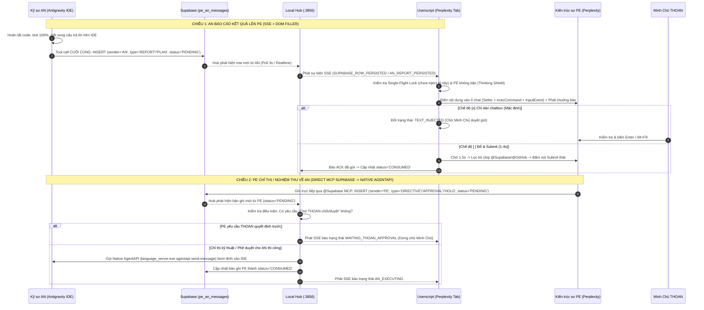

# TÀI LIỆU ĐẶC TẢ TOÀN DIỆN, KIỂM TOÁN LỊCH SỬ PHIÊN BẢN & CHẨN ĐOÁN LỖI CẦU NỐI PE-AN (REALTIME BRIDGE)

- **Mã tài liệu:** `DOC-BRIDGE-AUDIT-20261014`
- **Ngày lập:** `2026-10-14 08:12 JST`
- **Phạm vi kiểm toán:** Toàn bộ các phiên bản Bridge trên `ysdms-nextgen` và `omnilinguist` (`v1.0` $\rightarrow$ `v2.4.0` và nhánh `v3.3` $\rightarrow$ `v3.13`)
- **Người thực hiện:** Kỹ sư AN (Antigravity)
- **Đệ trình:** Minh Chủ THOAN & Kiến trúc sư trưởng PE

---

## PHẦN 1: TỔNG HỢP LỊCH SỬ TOÀN BỘ 11 PHIÊN BẢN BRIDGE ĐÃ TẠO

Qua rà soát toàn bộ Git log, thư mục `tools/realtime-bridge/`, `docs/realtime-bridge/`, `scripts/` và đối chiếu chéo với kho lưu trữ `omnilinguist`, hệ thống Cầu nối PE-AN đã trải qua **2 nhánh phát triển lớn (11 phiên bản)**:

### 1.1. Nhánh A — Dòng Perplexity Bridge Thế Hệ 1 (`v3.3` $\rightarrow$ `v3.13`)
*Lưu trữ tại: `docs/realtime-bridge/Bridge_Userscript_v3.8.js` .. `v3.13.js` & `scripts/local_realtime_hub.js`*

| Phiên bản | File chính | Cổng Hub | Đặc điểm & Thay đổi chính |
| :--- | :--- | :---: | :--- |
| **v3.3** | `pe_an_bridge_two_way_toast.user.js` | `3456` | Bản 2 chiều đầu tiên. Panel góc phải dưới, tự động đổi màu Vàng (chờ nạp vào PE) $\rightarrow$ Xanh (chờ gửi sang AN). |
| **v3.8** | `Bridge_Userscript_v3.8.js` | `7654` | Thêm xác thực `x-bridge-token`, Anti-forgery check đối chiếu Supabase, Idempotency cache chống gửi trùng. |
| **v3.9** | `Bridge_Userscript_v3.9.js` | `7654` | Thêm nút `🔄 Lấy tin mới từ Supabase` (Manual Pull) khi SSE bị ngắt. |
| **v3.10** | `Bridge_Userscript_v3.10.js` | `7654` | Tách biệt trạng thái kết nối SSE và Polling fallback. |
| **v3.11** | `Bridge_Userscript_v3.11.js` | `7654` | Khắc phục lỗi chặn mạng nội bộ của Chrome (**CORS + Private Network Access PNA** `Access-Control-Allow-Private-Network: true`), thêm nút chọn Port (`:7654`). |
| **v3.12** | `Bridge_Userscript_v3.12.js` | `7654` | Chuyển sang **Light Theme (Giao diện sáng)**, hỗ trợ **Kéo thả tự do (Draggable)** lưu tọa độ `localStorage`, **Thu gọn thành viên thuốc (Collapsible Mini Pill)**, và **Robust Input Filler** (hỗ trợ cả `textarea` lẫn `div[contenteditable="true"]` Lexical/ProseMirror). |
| **v3.13** | `Bridge_Userscript_v3.13.js` | `7654` | **Context-Aware Dynamic UI**: Nút bấm chính tự động biến hình theo ngữ cảnh (`🚀 Đổ báo cáo vào PE` màu xanh lá / `📥 Gửi lệnh sang AN` màu xanh dương / `⚙️ AN đang thi công...` màu xám). Thêm nút `📋 Copy tin mới nhất` và `✏️ Điền tay`. |

### 1.2. Nhánh B — Dòng Dedicated Hub Đa Tầng (`v1.0` $\rightarrow$ `v2.4.0`)
*Lưu trữ tại: `tools/realtime-bridge/ysdms_pe_bridge.user.js` & `tools/realtime-bridge/ysdms_realtime_hub.cjs`*

| Phiên bản | Commit / Nguồn | Cổng Hub | Đặc điểm & Thay đổi chính |
| :--- | :--- | :---: | :--- |
| **v1.0 – v2.1** | `omni_pe_bridge.user.js` (3.418 dòng) | `3956` | Kiến trúc chuẩn `SPEC-BRIDGE-SEC-001 v1.0.2`: **4-Tier State Machine** (`Turn`, `Delivery`, `Activity`, `Transport`), **Persist-First Dispatch**, **Correlation Ledger** (`in_reply_to_message_id`), **SSOT Message Feed Viewer** (`👁️ Xem tin`), **Manual Test Slice** (`🧪 Test Hai Đầu`), chuông **Web Audio API**, và tùy chọn **Không dấu (`Alt+F8`)** chống lỗi KaTeX. |
| **v2.2.0** | `e50416b` | `3856` | Chuyên biệt hóa cho YSDMS (`public.pe_an_messages`). Tích hợp **Native AgentAPI Wakeup** (`language_server.exe agentapi send-message`) để đánh thức trực tiếp khung chat Antigravity IDE. Có 2 checkbox: `[ ] Đổ & Submit (1-4s)` và `[x] Chỉ dán chatbox`. |
| **v2.3.0** | `a992df2` | `3856` | Thêm **Single Dispatch Guard** (`injectedReports` lock chống đổ lặp nhiều lần vào ô chat) và **Thinking Shield / Busy State** (`isPerplexityBusy()` chờ PE suy nghĩ xong mới dán). |
| **v2.3.1** | `6e97d5a` (3.732 dòng) | `3856` | Thêm **Connector Tag Isolation** (`isExcludedButton` lọc bỏ các chip `@Supabase`, `@GitHub` trên khung chat Perplexity để không nhận nhầm là text hoặc nút Submit) và **Manual Override Enablement**. |
| **v2.4.0** | `44094a7` / `5bbcf6a` (452 dòng) | `3856` | Thực thi **Phương án 2 (Dual-Path)**: Gỡ bỏ 100% cơ chế cào DOM ngầm ở chiều PE $\rightarrow$ AN (vì PE đã ghi trực tiếp lên Supabase qua MCP), chỉ giữ SSE nhận báo cáo AN và nút cứu hộ `Alt+F10`. **Tuy nhiên do viết rút gọn lại từ đầu (từ 3.732 dòng xuống 452 dòng) nên làm phát sinh 4 lỗi hồi quy nghiêm trọng (xem Phần 3).** |

---

## PHẦN 2: MÔ TẢ CHI TIẾT TÍNH NĂNG, YÊU CẦU HOẠT ĐỘNG, LOGIC & QUY TRÌNH CỦA BRIDGE

### 2.1. Yêu Cầu Thiết Kế Giao Diện (UI/UX Requirements Từ Minh Chủ THOAN)
1. **Giao diện Sáng (Light Theme), Sắc nét, Không che khuất:**
   - Nền trắng sáng (`#FFFFFF`), chữ đậm sắc nét (`#0F172A`), viền thanh mảnh, đổ bóng nhẹ.
   - Cho phép **kéo thả tự do (Draggable)** bằng chuột trên thanh tiêu đề và tự động ghi nhớ vị trí vào `localStorage`.
   - Cho phép **thu gọn (Minimize / Collapsible)** thành một thanh/viên thuốc nhỏ (`Mini Pill`) chỉ hiện đèn trạng thái + tên trạng thái, bấm vào lại mở rộng ra.
2. **Hiển thị Trạng thái Trung thực (4-Tier State Visibility):**
   - Không gộp chung trạng thái. Hiển thị rõ:
     - **Lượt (Turn State):** `IDLE`, `WAITING_FOR_PE`, `PE_THINKING`, `WAITING_FOR_AN`, `AN_EXECUTING`, `WAITING_THOAN_APPROVAL`, `ERROR_HOLD`.
     - **Vận chuyển (Delivery State):** `ROW_PERSISTED` (đã lưu DB), `TEXT_INJECTED` (đã điền vào ô chat nhưng chưa gửi), `SUBMITTED` (đã bấm gửi), `CONSUMED` (đến đích thành công).
     - **Kết nối (Transport Badge):** Đèn xanh/đỏ báo trạng thái kết nối SSE tới Local Hub `:3856` + nút đổi cổng khi cần.
3. **Bộ Công Cụ Điều Khiển Trực Quan Cho Minh Chủ:**
   - **Tùy chọn chế độ tự động (2 Checkbox tách biệt, loại trừ nhau):**
     - `[x] Chỉ dán chatbox` *(Mặc định an toàn — Dual-Shield Gatekeeper)*: Khi có báo cáo từ AN, tự động đổ vào ô chat Perplexity và kêu chuông báo, chờ Minh Chủ kiểm tra rồi bấm gửi.
     - `[ ] Đổ & Submit (1-4s)`: Khi Minh Chủ bật chế độ rảnh tay, tự động đổ vào ô chat, đợi 1.5s–3.5s cho React nhận state rồi tự động bấm nút Submit trên Perplexity.
   - **Tùy chọn `[ ] Không dấu (Alt+F8)`:** Chuyển nội dung tiếng Việt có dấu sang không dấu trước khi điền vào Perplexity để tránh lỗi nhảy chữ/lỗi KaTeX khi cần.
   - **Nút hành động chính (Primary Action Button):**
     - `🚀 Gửi ngay cho PE (Alt+F9)`: Điền báo cáo mới nhất của AN vào ô chat Perplexity và kích hoạt gửi.
     - `📥 Cứu hộ: Bắn sang AN (Alt+F10)`: Khi MCP Supabase của PE bị nghẽn, cho phép quét câu trả lời cuối của PE trên màn hình hoặc văn bản đang bôi đen để đẩy thẳng về Local Hub $\rightarrow$ đánh thức AN.
   - **Thanh công cụ phụ (Utility Bar):**
     - `🔄 Làm mới (Alt+F5)`: Chủ động kéo bản ghi mới nhất từ Supabase qua Hub về trình duyệt.
     - `👁️ Xem tin (SSOT Feed Drawer)`: Mở ngăn kéo xem danh sách các bản ghi `pe_an_messages` trực tiếp từ Supabase (`id`, `sender`, `message_type`, `status`, `created_at`, nút nạp lại từng tin).
     - `⏸️ Tạm dừng / ▶️ Tiếp tục`: Tạm khóa tự động điền khi Minh Chủ đang gõ dở câu hỏi riêng trên Perplexity.

### 2.2. Logic & Quy Trình Hoạt Động Chuẩn (Dual-Path Architecture)



---

## PHẦN 3: DANH MỤC CÁC LỖI ĐÃ PHÁT SINH & NGUYÊN NHÂN GỐC RỄ

### 3.1. Các lỗi lịch sử từ `v1.0` đến `v2.3.1` (Đã được nhận diện & xử lý trong quá khứ)

| Mã lỗi | Hiện tượng lỗi | Nguyên nhân gốc rễ | Cách đã khắc phục (ở `v2.3.1` / Hub) |
| :--- | :--- | :--- | :--- |
| **BUG-01** | **Sai thứ tự lượt của AN:** Chưa trả lời xong trên IDE đã bắn tin lên Perplexity. | AN gọi script đẩy lên Supabase ở giữa chuỗi tool calls thay vì ở bước cuối cùng. | Ban hành `RULE-PROC-02`: AN chỉ được gọi lệnh insert Supabase ở **tool call cuối cùng** ngay trước khi kết thúc lượt trả lời. |
| **BUG-02** | **Đổ lặp báo cáo liên tục vào ô chat Perplexity.** | Khi chọn `Chỉ dán chatbox`, bản ghi vẫn ở trạng thái `PENDING` (vì chưa submit). Chu kỳ poll 3s tiếp theo thấy `PENDING` lại tiếp tục đổ đè vào ô chat. | Bổ sung bộ khóa `injectedReports` (`markReportInjected(id)`) trong `sessionStorage` để mỗi `message_id` chỉ tự động điền đúng 1 lần. |
| **BUG-03** | **Khi F5 trình duyệt, chưa dán nhưng đã báo "Đang chờ PE thực hiện".** | Gộp trạng thái "có bản ghi trên DB" với trạng thái "đã gửi cho PE", hoặc cố điền ngay tích tắc đầu khi trang SPA Perplexity chưa render xong `textarea` nhưng vẫn chuyển state thành công. | Tách bạch trạng thái `ROW_PERSISTED` (mới có trên DB) và `TEXT_INJECTED` (chỉ chuyển khi hàm `injectIntoPerplexityEditor()` trả về `true` thực sự). |
| **BUG-04** | **`Uncaught SyntaxError: Failed to execute 'appendChild' on 'Node': Unexpected token ','`** | Xung đột khi inject script/style vào DOM lúc Perplexity SPA đang hydrate. | Bọc khởi tạo UI trong hàm chờ `document.body` ổn định và chỉ gắn style qua `document.createElement('style')` với `textContent` thuần. |
| **BUG-05** | **Kẹt không tự dán / không tự Submit được khi khung chat Perplexity có chip `@Supabase`, `@GitHub`.** | Các thẻ chip connector (`@Supabase`, `@GitHub`) nằm trong vùng editor/toolbar làm script tưởng ô chat đang có chữ người dùng gõ dở, hoặc hàm tìm nút Submit bấm nhầm vào nút xóa chip `@Supabase`. | Trong `v2.3.1`, bổ sung hàm `stripConnectorTokens()` và `isExcludedButton()` loại trừ mọi nút/chip có chữ `supabase`, `github`, `connector`, `source`, `model`, `attach`, `voice`. |
| **BUG-06** | **Chiều PE $\rightarrow$ AN không tự kích hoạt AN thực thi dù PE đã ghi lên Supabase.** | Trong `ysdms_realtime_hub.cjs` có hàm `isDirectiveTargetingAn()` dùng danh sách 21 từ khóa cứng nhắc; khi PE viết câu tự nhiên không khớp từ khóa thì Hub tự ý chặn lại. | Đã sửa `isDirectiveTargetingAn()` trong Hub: **Mặc định trả về `true` cho mọi tin nhắn từ PE** (vì AN có khả năng tự đọc hiểu), chỉ tạm dừng khi PE ghi rõ *"Chờ THOAN chốt/duyệt"*. |
| **BUG-07** | **Bắn đúp 2 lần cùng 1 chỉ thị vào khung chat Antigravity IDE.** | Chạy đồng thời cả 2 tiến trình nền: `ysdms_realtime_hub.cjs` và `scripts/watch_directive.py` cùng quét bảng `pe_an_messages` và cùng gọi `agentapi send-message`. | Quy hoạch lại: Chỉ dùng duy nhất `ysdms_realtime_hub.cjs` làm daemon điều phối. |

---

### 3.2. BỐN (04) LỖI HỒI QUY NGHIÊM TRỌNG TRONG BẢN `v2.4.0` HIỆN TẠI (Nguyên nhân làm Bridge đang mất tác dụng)

Khi chuyển sang `v2.4.0` (commit `44094a7` / `5bbcf6a`), việc xóa bỏ toàn bộ file `v2.3.1` (3.732 dòng) để viết lại một file rút gọn chỉ 452 dòng đã gây ra **4 lỗi đứt gãy giao thức và mất tính năng cốt lõi**:

1. **BUG-08A (Đứt gãy tên sự kiện SSE giữa Hub và Userscript `v2.4.0`):**
   - Trong `ysdms_realtime_hub.cjs` (dòng 371, 616, 1528), khi có báo cáo mới từ AN, Hub phát sự kiện SSE tên là:
     `SUPABASE_ROW_PERSISTED`, `AN_REPORT_PERSISTED`, hoặc `AN_REPORT_DONE`.
   - Nhưng trong `ysdms_pe_bridge.user.js v2.4.0` (dòng 315), code lại kiểm tra:
     ```javascript
     if (data.type === 'AN_REPORT_DISPATCHED' || data.type === 'AN_REPORT_READY' || (data.payload && data.payload.sender === 'AN'))
     ```
     Trong khi đó, cấu trúc gói tin SSE của Hub đặt dữ liệu ở `data.row` hoặc `data.content` (không có `data.payload.sender`).
   - **Hậu quả:** Khi AN đẩy báo cáo lên Supabase, Hub có phát SSE nhưng **Userscript `v2.4.0` hoàn toàn bỏ qua, không điền vào ô chat Perplexity!**

2. **BUG-08B (Lỗi HTTP 400 ở nút Cứu hộ `Alt+F10` do lệch tên trường JSON):**
   - Trong `ysdms_realtime_hub.cjs` (dòng 1351), endpoint `POST /api/directive` yêu cầu trường `directiveText`:
     ```javascript
     const rawText = String(body.directiveText || '');
     if (!rawText.trim()) { sendJson(res, 400, { error: 'directiveText is required' }); return; }
     ```
   - Nhưng trong `ysdms_pe_bridge.user.js v2.4.0` (dòng 223), hàm `rescueSendPeToAn()` lại gửi:
     ```javascript
     body: JSON.stringify({ directive: textToSend, ... })
     ```
   - **Hậu quả:** Bấm nút cứu hộ `Alt+F10` luôn bị Hub từ chối với lỗi `400 Bad Request: directiveText is required`!

3. **BUG-08C (Hub bỏ qua tin nhắn do lệch Whitelist `thread_id`):**
   - Userscript `v2.4.0` (dòng 31) đặt `DEFAULT_THREAD_ID = "BRIDGE-ORCHESTRATION"`.
   - Các Work Order của PE gần đây dùng `thread_id = "WO-BRIDGE-V2.4.0"` hoặc `"BRIDGE-ORCHESTRATION"`.
   - Nhưng trong `ysdms_realtime_hub.cjs` (dòng 93), danh sách `ALLOWED_THREAD_PREFIXES` chỉ gồm:
     `['YSDMS-', 'AUTH-', 'PROD-', 'CYCLE-', 'TEST-', 'ARCHITECTURE-', 'WO-']` — **không có `'BRIDGE-'`**!
   - **Hậu quả:** Mọi bản ghi có `thread_id` bắt đầu bằng `BRIDGE-` (như bản ghi `927288de...` mới nhất của AN) đều bị hàm `isAllowedThread()` của Hub lọc bỏ!

4. **BUG-08D (Mất hàng loạt tính năng giao diện & an toàn từ `v2.3.1` / `v3.13`):**
   - Giao diện `v2.4.0` bị quay về nền tối đen cứng nhắc (`#0f172a`), **không kéo thả được (No Drag)**, **không thu gọn được (No Collapse)**.
   - **Mất khung xem tin `SSOT Feed Viewer` (`👁️ Xem tin`)** và **mất nút `🔄 Làm mới từ Supabase`**, khiến Minh Chủ không thể nhìn thấy danh sách tin nhắn đang nằm trên Supabase hay chủ động nạp lại một tin bất kỳ.
   - **Mất tách biệt 2 chế độ `[x] Chỉ dán chatbox` và `[ ] Đổ & Submit (1-4s)`** (trong `v2.4.0` gộp thành 1 checkbox `Tự động dán báo cáo AN` nhưng lại gọi luôn `tryClickSubmit()` sau 600ms!).
   - **Mất bộ lọc chip `@Supabase` / `@GitHub` (`isExcludedButton`)** trong hàm `tryClickSubmit()`, dẫn đến nguy cơ bấm nhầm vào chip `@Supabase` trên khung chat Perplexity.

---

## PHẦN 4: TÌNH TRẠNG HIỆN TẠI CỦA HỆ THỐNG (LIVE STATUS)

1. **Trạng thái Tiến trình Local Hub (`:3856`):**
   - Kiểm tra qua `netstat -ano`: Cổng `3856` hiện **ĐANG TẮT (Offline)** do máy chủ vừa khởi động lại phiên mới lúc 08:03 JST.
2. **Trạng thái Bảng `public.pe_an_messages` trên Supabase:**
   - Kết nối Supabase hoạt động tốt (200 OK).
   - 5 bản ghi gần nhất trên bảng `pe_an_messages`:
     - `927288de-5287-42ee-a009-35b1fa895354` | `sender: AN` | `type: REPORT` | `thread: BRIDGE-ORCHESTRATION` | `status: PENDING` (Báo cáo nghiệm thu `v2.4.0` của AN đang chờ gửi cho PE).
     - `f8eb4ebf-60ac-44d7-8912-026645fba068` | `sender: PE` | `type: APPROVAL` | `thread: WO-BRIDGE-V2.4.0` | `status: PENDING` (PE phê duyệt kế hoạch Dual-Path `v2.4.0` và dặn kiểm tra kỹ thread sync của Hub).
     - `b720b341-70ef-41cb-b273-efbbab7601dd` | `sender: AN` | `type: PLAN` | `thread: BRIDGE-ORCHESTRATION` | `status: PENDING`.
3. **Trạng thái Mã nguồn:**
   - File `tools/realtime-bridge/ysdms_realtime_hub.cjs` (1.818 dòng): Đã có Native AgentAPI wakeup và đã bỏ bộ lọc từ khóa cứng nhắc, nhưng thiếu tiền tố `'BRIDGE-'` trong `ALLOWED_THREAD_PREFIXES`.
   - File `tools/realtime-bridge/ysdms_pe_bridge.user.js` (452 dòng - bản `v2.4.0`): Đang mắc 4 lỗi hồi quy `BUG-08A`, `BUG-08B`, `BUG-08C`, `BUG-08D` nêu tại Phần 3.2.

---

## PHẦN 5: ĐỀ XUẤT PHƯƠNG ÁN KHẮC PHỤC DỨT ĐIỂM — `BRIDGE v2.5.0 (UNIFIED GOLD EDITION)`

Để giải quyết triệt để mọi lỗi phát sinh và đáp ứng trọn vẹn 100% yêu cầu về tính năng lẫn thẩm mỹ giao diện của Minh Chủ THOAN, AN đệ trình phương án hợp nhất **`Bridge v2.5.0 (Unified Gold Edition)`** gồm 4 hạng mục rõ ràng sau đây:

### Đề xuất 1: Đồng bộ 100% Giao thức giữa Hub (`ysdms_realtime_hub.cjs`) và Userscript (`ysdms_pe_bridge.user.js`)
1. **Mở rộng `ALLOWED_THREAD_PREFIXES` trong Hub:** Thêm `'BRIDGE-'`, `'GENERAL'`, `'DEFAULT'` (hoặc cho phép mọi `thread_id` hợp lệ trên bảng `pe_an_messages` của dự án YSDMS) để không bao giờ bị rơi mất tin nhắn giữa AN và PE.
2. **Chuẩn hóa Sự kiện SSE Chiều AN $\rightarrow$ PE:** Userscript lắng nghe đồng thời `SUPABASE_ROW_PERSISTED`, `AN_REPORT_PERSISTED`, `AN_REPORT_DONE` và đọc đúng trường `data.row` / `data.content`. Kèm theo cơ chế **Polling Fallback 3 giây** tới `GET /api/messages/feed` để ngay cả khi SSE bị đứt thoáng qua hoặc khi vừa F5 trang, báo cáo mới nhất của AN vẫn được nhận diện ngay lập tức.
3. **Chuẩn hóa Payload Cứu hộ `Alt+F10`:** Sửa payload gửi lên `POST /api/directive` dùng đúng khóa `directiveText` + `threadId` để nút Cứu hộ `Alt+F10` hoạt động 100% không lỗi 400.

### Đề xuất 2: Khôi phục Giao diện Sáng (Light Theme), Kéo Thả, Thu Gọn & Ngăn Kéo Xem Tin SSOT
Thiết kế lại UI của `ysdms_pe_bridge.user.js v2.5.0` kế thừa tinh hoa của `v3.13` và `v2.3.1`:
- **Light Theme hiện đại, sắc nét:** Nền trắng `#FFFFFF`, chữ `#0F172A`, thanh tiêu đề kéo thả mượt mà (**Draggable** lưu vị trí), có nút `_` thu gọn thành **Mini Pill** (`🟢 Bridge v2.5 • Sẵn sàng`) không chiếm diện tích màn hình.
- **Hiển thị rõ ràng 2 Checkbox chế độ điều khiển của Minh Chủ:**
  - `[x] Chỉ dán chatbox` *(Mặc định)*: Chỉ điền vào ô chat + phát chuông báo, tuyệt đối không tự bấm gửi.
  - `[ ] Đổ & Submit (1-4s)`: Điền xong, chờ 1.5s–3s rồi tự động bấm nút Submit.
  - `[ ] Không dấu (Alt+F8)`: Chuyển tiếng Việt không dấu khi cần.
- **Khôi phục Ngăn kéo `👁️ Xem tin (SSOT Feed)` & Nút `🔄 Làm mới (Alt+F5)`:** Cho phép Minh Chủ xem trực tiếp 10 tin nhắn gần nhất trên bảng `pe_an_messages` (ai gửi, loại tin, trạng thái `PENDING`/`CONSUMED`) và có nút **`[Đổ vào ô chat]`** ngay trên từng dòng tin nhắn để chủ động nạp lại bất kỳ lúc nào.

### Đề xuất 3: Khôi phục Bộ Điền & Submit Chống Kẹt Chip `@Supabase` / `@GitHub` + Khóa Chống Đổ Lặp
- Tích hợp nguyên vẹn hàm `isExcludedButton()` và `stripConnectorTokens()` từ `v2.3.1` vào `v2.5.0`: Đảm bảo khi khung chat Perplexity đang gắn `@Supabase` và `@GitHub`, Bridge vẫn điền văn bản chính xác vào editor và khi bấm Submit sẽ bấm đúng nút gửi của Perplexity (không chạm vào chip connector).
- Tích hợp khóa `injectedMessageIds` (`sessionStorage` + `localStorage`) kết hợp kiểm tra kết quả trả về của `injectIntoEditor()`:
  - Chỉ khi điền thành công vào DOM thật mới chuyển sang trạng thái `TEXT_INJECTED` (đã dán).
  - Nếu F5 mà chưa điền, trạng thái hiển thị đúng là `📥 Có báo cáo AN mới (Chờ dán)`.
  - Mỗi `message_id` chỉ tự động điền 1 lần duy nhất, không bao giờ đổ lặp.

### Đề xuất 4: Giữ Kiến Trúc Dual-Path Tinh Gọn (Không Cào DOM Ngầm Chiều PE $\rightarrow$ AN) & Duy Nhất 1 Daemon
- Giữ nguyên quyết định kiến trúc của `v2.4.0`: **Không dùng MutationObserver cào DOM ngầm ở chiều PE $\rightarrow$ AN** để mã nguồn sạch, nhẹ (~750 dòng thay vì 3.700 dòng), không bị rò rỉ bộ nhớ hay bắt nhầm text rác trên giao diện Perplexity.
- Chiều PE $\rightarrow$ AN đi thẳng từ **PE (`@Supabase` MCP)** $\rightarrow$ **Bảng `pe_an_messages`** $\rightarrow$ **Local Hub (`ysdms_realtime_hub.cjs`)** $\rightarrow$ **Native AgentAPI (`language_server.exe`)** đánh thức AN.
- Khi cần gửi thủ công từ giao diện Perplexity về AN, Minh Chủ chỉ cần bấm **`📥 Cứu hộ: Bắn sang AN (Alt+F10)`**.
- Khởi động lại duy nhất `ysdms_realtime_hub.cjs` ở cổng `3856` (không chạy `watch_directive.py` để tránh bắn đúp 2 lần vào IDE).
