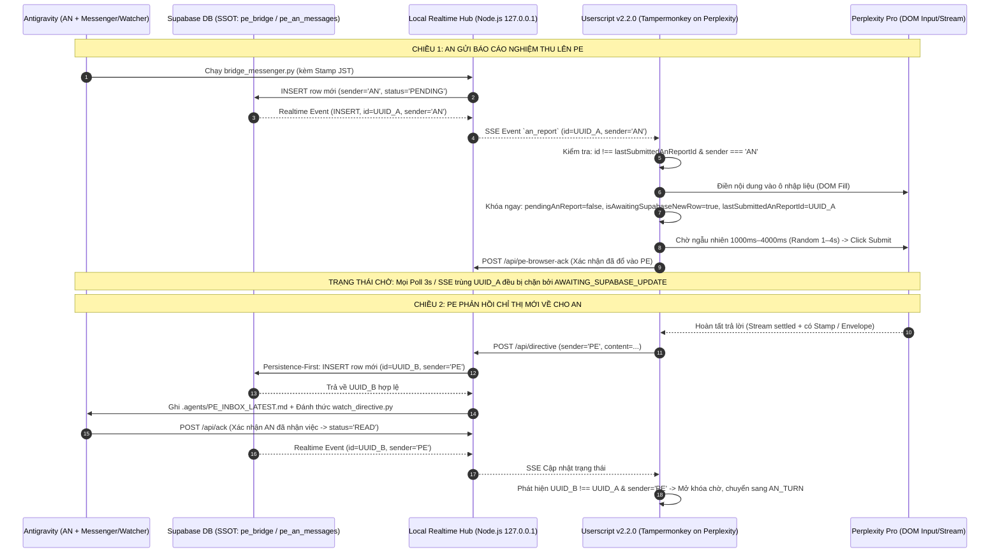

# TÀI LIỆU TỔNG HỢP KIỂM TOÁN, KIẾN TRÚC, LỊCH SỬ LỖI & ĐỀ XUẤT HỆ THỐNG REALTIME BRIDGE (PE ⟷ THOAN ⟷ AN)

- **Mã tài liệu:** `DOC-BRIDGE-MASTER-20261014`
- **Phiên bản chuẩn hiện hành:** `v2.2.0` (Gen 3 — Sender-Routed Autopilot & Security Hardened)
- **Phạm vi áp dụng:**
  1. Dự án **OmniLinguist** (`d:\AntiGravity_Workspace\apps\omnilinguist\tools\realtime-bridge`)
  2. Dự án **YSDMS NextGen** (`D:\AntiGravity_Workspace\apps\ysdms-nextgen\tools\realtime-bridge`)
- **Ngày lập báo cáo:** `2026-10-14 JST`

---

## PHẦN 1: TỔNG QUAN LỊCH SỬ TIẾN HÓA CÁC PHIÊN BẢN BRIDGE

Qua rà soát toàn bộ lịch sử Git (`40+ commits` trên nhánh `rebuild/v3` của OmniLinguist và lịch sử của YSDMS NextGen), hệ thống cầu nối PE–AN đã trải qua **3 thế hệ (Generations)** với hơn **20 phiên bản**:

| Thế hệ | Phiên bản | Thư mục / Tệp đại diện | Đặc điểm kiến trúc chính | Tình trạng |
|---|---|---|---|---|
| **Gen 1.0** | `v1.0` – `v2.0` | `ysdms-nextgen/scripts/pe_an_bridge_app.py` `pe_bridge_watcher.py` | Ứng dụng Desktop Python Tkinter + Polling Supabase mỗi 15 giây + Windows Balloon Toast. | 🔴 Đã ngừng dùng (Legacy) |
| **Gen 1.5** | `v3.6.2` | `omnilinguist/tools/userscript/pe_an_bridge_two_way_toast.user.js` | Userscript đời đầu gọi thẳng REST/Realtime tới Supabase; nhúng `anon_key` trực tiếp trong script; `@connect *`. | 🔴 Đã ngừng dùng (Legacy) |
| **Gen 1.8** | `v3.8` – `v3.13` | `ysdms-nextgen/docs/realtime-bridge/Bridge_Userscript_v3.8..v3.13.js` + `local_realtime_hub.js` | Qua Local Gateway (`127.0.0.1:7654` / `3456`); giao diện sáng (Light theme), kéo thả, thu gọn; chưa có khóa chống bơm lặp và phân luồng sender chặt chẽ. | 🟡 Đã thay thế bởi `v2.2.0` |
| **Gen 2.0** | `v1.0.0` – `v1.0.3` | `omnilinguist/tools/PE-bridge/` (bản nháp) `omnilinguist/tools/realtime-bridge/` | Tách cổng riêng `3956+`, bảng `public.pe_bridge`; kiến trúc **4-Tier State Machine**, **Persistence-First Dispatch** (ghi DB trước khi ghi file inbox), `GM_xmlhttpRequest` vượt rào cản PNA/CORS. | 🟡 Nền tảng lõi |
| **Gen 2.5** | `v1.0.4` – `v1.0.16` | `omnilinguist/tools/realtime-bridge/omni_pe_bridge.user.js` | Bổ sung `pe_handoff_ledger.json` (12 trường đối soát), `pe_report_correlation.json`, JST Timestamp, lọc nhiễu nút `@GitHub`/`@Supabase` trên Perplexity, Single-Flight Lock. | 🟡 Đã nâng cấp lên Gen 3 |
| **Gen 3.0** | `v2.0.0` (`SPEC-BRIDGE-SEC-001`) | `omni_realtime_hub.cjs` + `omni_pe_bridge.user.js` | Đóng lỗ hổng bảo mật: bỏ `@connect *`, bỏ CORS wildcard `*`, thêm kiểm tra RFC Loopback `Host` header, dải cổng động `3856–3885` & `3956–3985`, không lưu khóa bí mật ở trình duyệt, Observable DOM Waiter. | 🟢 Đã tích hợp vào `v2.2.0` |
| **Gen 3.1** | `v2.1.0` | Commit `323a764` | Tích hợp theo yêu cầu Minh Chủ: **Auto-Submit trong chế độ Auto với độ trễ ngẫu nhiên 1–4 giây** (`1000ms–4000ms`), đếm ngược trực quan, phím hủy khẩn cấp `ESC`/`Space`. | 🟢 Đã tích hợp vào `v2.2.0` |
| **Gen 3.2** | **`v2.2.0`** *(Hiện hành)* | `omnilinguist/tools/realtime-bridge/` `ysdms-nextgen/tools/realtime-bridge/` | Khắc phục triệt để lỗi đổ dữ liệu lặp liên tục vào PE: bổ sung khóa `isAwaitingSupabaseNewRow`, đối chiếu `lastSubmittedAnReportId`, và **Sender-Based Turn Routing** (`PE`/`THOAN` ➔ AN; `AN` ➔ PE). | ✅ **PRODUCTION (Chuẩn hiện hành)** |

---

## PHẦN 2: MÔ TẢ CHI TIẾT TÍNH NĂNG, YÊU CẦU HOẠT ĐỘNG, LOGIC & QUY TRÌNH CỦA BRIDGE (`v2.2.0`)

### 2.1. Tổng hợp các yêu cầu từ Minh Chủ (User Requirements) & Kiểm toán viên (PE)
1. **Tiền tố phiên bản bắt buộc (Rule 3.5):** Tên Userscript bắt buộc đặt phiên bản ở ngay **ĐẦU** theo cú pháp `[vX.Y.Z] Tên Tiện Ích` (ví dụ: `[v2.2.0] OmniLinguist Realtime Bridge...`) để phân biệt tức thì trên Tampermonkey.
2. **Quản lý cổng mạng động (Rule 2):** Không dùng cổng cố định dễ xung đột (`3000`, `5000`, `8080`). Tự động tăng cổng (`port + 1`) khi gặp `EADDRINUSE` (`3956+` cho OmniLinguist, `3856+` cho YSDMS NextGen).
3. **Stamp thời gian bắt buộc (Rule 4 & Dual Evidence C5):** Mọi gói tin gửi lên Supabase phải gắn dấu thời gian `⏱️ [GỬI SUPABASE: YYYY-MM-DD HH:MM:SS JST]` để đối soát chéo với cột `created_at` của server.
4. **Thiết kế giao diện (UI/UX) trên Perplexity:**
   - Giao diện nổi (Floating Widget) gọn nhẹ, kéo thả mượt (Smooth Dragging), có nút Thu gọn/Phóng to (`—` / `□`) lưu trạng thái vào `localStorage`.
   - Hiển thị rõ 4 thông số thời gian thực: Trạng thái kết nối Hub (`ONLINE`/`OFFLINE`), Lượt hiện tại (`PE_TURN` / `AN_TURN` / `AWAITING_DB`), Đếm ngược Auto-Submit, và Khung xem nhanh nội dung gói tin (`Message Viewer`).
   - Có công tắc bật/tắt nhanh chế độ **Auto Mode** và chế độ **Auto-Submit (1–4s)** hoặc **Fill-Only (Chỉ dán, chờ bấm tay)**.
5. **Tự động hóa khép kín (Zero-Click / 1-Click Autopilot):**
   - Chiều **AN ➔ PE**: Khi AN gửi báo cáo mới lên Supabase, Userscript tự động điền (Fill) vào ô chat Perplexity. Nếu bật Auto-Submit, hệ thống chọn ngẫu nhiên một thời điểm trong khoảng **1.0s – 4.0s** để tự động bấm nút Gửi (không chờ cứng hết 4s).
   - Chiều **PE ➔ AN**: Khi PE trả lời xong (kết thúc stream), Userscript trích xuất chỉ thị, gửi về Local Hub để lưu lên Supabase trước (**Persistence-First**), sau đó ghi vào `.agents/PE_INBOX_LATEST.md` và đánh thức AN qua `watch_directive.py`.
6. **Chống đổ dữ liệu lặp & Phân luồng đúng người nhận (Yêu cầu cốt lõi v2.2.0):**
   - Sau khi đổ báo cáo của AN vào PE và submit, hệ thống **phải khóa ngay lập tức** và chuyển sang trạng thái chờ (`AWAITING_SUPABASE_UPDATE`).
   - Tuyệt đối không được đổ lại báo cáo cũ khi Polling 3s hoặc SSE gửi lại bản tin cũ.
   - Chỉ khi Supabase xuất hiện **bản ghi mới (`record.id` mới)**, hệ thống mới kiểm tra trường `sender`:
     - Nếu `sender === 'PE'` hoặc `'THOAN'` ➔ Chuyển lượt cho **AN** xử lý (`AN_TURN`).
     - Nếu `sender === 'AN'` (báo cáo mới) ➔ Chuyển lượt cho **PE** thẩm định (`PE_TURN`).

---

### 2.2. Kiến trúc 3 tầng & Sơ đồ luồng dữ liệu (Data Flow)

---

### 2.3. Logic Máy Trạng Thái 4 Tầng (4-Tier State Machine) & Cơ chế khóa `v2.2.0`

Hệ thống loại bỏ hoàn toàn các biến cờ rời rạc của thế hệ cũ, thay bằng **4 tầng trạng thái độc lập** kết hợp **Khóa chống bơm lặp 3 lớp**:

1. **Tầng 1 — Turn State (Quyền đi nước cờ - Nguồn sự thật từ cột `sender` mới nhất trên Supabase):**
   - `PE_TURN`: Bản ghi mới nhất trên Supabase có `sender === 'AN'`. Đến lượt PE đọc báo cáo và ra phán quyết.
   - `AN_TURN`: Bản ghi mới nhất trên Supabase có `sender === 'PE'` hoặc `'THOAN'`. Đến lượt AN thi công.
   - `IDLE`: Chưa có phiên hoạt động.
2. **Tầng 2 — Post-Injection Lock State (Khóa chờ cập nhật Supabase sau khi bơm — `v2.2.0`):**
   - `lastSubmittedAnReportId`: Lưu cứng UUID của báo cáo AN vừa được điền/submit vào Perplexity.
   - `isAwaitingSupabaseNewRow`: Đặt bằng `true` ngay lập tức tại thời điểm điền báo cáo vào ô chat Perplexity. Khi cờ này bật:
     - Mọi chu kỳ Polling 3s hoặc sự kiện SSE phát lại báo cáo cũ đều bị chặn với mã `AWAITING_SUPABASE_UPDATE` hoặc `REPORT_ALREADY_SUBMITTED`.
     - Chỉ được giải phóng (`false`) khi Supabase trả về một bản ghi có `record.id !== lastSubmittedAnReportId`.
3. **Tầng 3 — Delivery & ACK Ledger (Sổ cái đối soát giao nhận):**
   - Theo dõi xuyên suốt từ `DIRECTIVE_PERSISTED` (đã lưu DB) ➔ `HUB_QUEUED` (đã ghi file `.agents/PE_INBOX_LATEST.json`) ➔ `WATCHER_DELIVERED` ➔ `AN_ACKED` (Watcher đã gọi `/api/ack`).
4. **Tầng 4 — Activity Overlay (Trạng thái hoạt động tức thời có TTL):**
   - `PE_THINKING` (chỉ bật khi `isPeRequestInFlight === true` và Perplexity đang stream, tự hết hạn sau TTL 60s).
   - `AN_WORKING` (khi AN đã ACK chỉ thị và đang xử lý, TTL 120s).

---

## PHẦN 3: DANH MỤC CÁC LỖI PHÁT SINH QUA CÁC PHIÊN BẢN & CÁCH KHẮC PHỤC

Dưới đây là toàn bộ **10 lỗi thực tế** đã phát sinh trong quá trình vận hành và kết quả xử lý:

| Mã lỗi | Mô tả hiện tượng lỗi | Nguyên nhân gốc rễ (Root Cause) | Cơ chế đã khắc phục (Resolution) | Trạng thái |
|---|---|---|---|---|
| **BUG-01** | **Đổ dữ liệu liên tục (Infinite Re-injection Loop) vào ô chat PE** *(Nghiêm trọng nhất)* | Sau khi Userscript điền và gửi báo cáo của AN vào PE, trong lúc PE đang suy nghĩ (chưa có dòng mới trên Supabase), chu kỳ Poll 3s hoặc SSE reconnect đọc lại dòng `sender='AN'` cũ và tiếp tục bơm lại vào ô chat PE. | Bổ sung trong **`v2.2.0`**: Khóa `pendingAnReport = false` và bật `isAwaitingSupabaseNewRow = true` + ghi nhận `lastSubmittedAnReportId` ngay khi bơm. Chặn mọi lượt bơm tiếp theo cho đến khi Supabase có bản ghi mới và kiểm tra `sender` để định tuyến. | ✅ **Đã xử lý triệt để (`v2.2.0`)** |
| **BUG-02** | **Tự động bấm nhầm nút `@GitHub` / `@Supabase` thay vì nút Send trên Perplexity** | Giao diện mới của Perplexity thêm các nút Connector (`@GitHub`, `@Supabase`, đính kèm file) nằm cùng vùng chứa với nút Submit. Selector cũ tìm `button` cuối cùng hoặc tìm rộng nên bấm nhầm. | Viết hàm `findPerplexitySubmitButton()` (`v1.0.15+`): loại trừ tường minh các nút chứa text/aria-label `@`, `connector`, `source`, `attach`, `model`, và kiểm tra trạng thái ô input đã rỗng sau khi click. | ✅ **Đã xử lý triệt để** |
| **BUG-03** | **Báo ảo trạng thái `[Stream]` / `PE_THINKING` khi bấm F5 tải lại trang** | Hàm `isPerplexityStreaming()` cũ quét chuỗi không dấu `'dung'` (từ chữ *"Dừng"*), vô tình khớp trúng các nút tiếng Việt tĩnh trên trang như *"Sao chép nội **dung**"*, *"Áp **dụng**"*, *"Sử **dụng**"*. | Thu hẹp phạm vi tìm nút Stop vào đúng vùng `textarea` container; bỏ khớp chuỗi con `'dung'`; yêu cầu cờ `isPeRequestInFlight === true` mới được bật `PE_THINKING`; thêm `rehydrateStateFromSupabase()` khi khởi động. | ✅ **Đã xử lý triệt để** |
| **BUG-04** | **Cắt cụt chỉ thị của PE (Mid-Stream Truncation)** | Khi Claude Sonnet Thinking tạm dừng giữa các đoạn suy luận, DOM ngừng thay đổi trong tích tắc khiến script tưởng đã trả lời xong và trích xuất thiếu nội dung. | Áp dụng **Envelope Protocol** (`=== PE-DIRECTIVE === ... === END ===` hoặc kiểm tra dấu mốc `⏱️ [HOÀN THÀNH: ...]`) kết hợp thời gian chờ ổn định (Settlement delay) và kiểm tra nút Stop biến mất hoàn toàn. | ✅ **Đã xử lý triệt để** |
| **BUG-05** | **Vòng lặp tự đọc lại câu hỏi của chính mình (Echo Back Loop)** | Hàm quét `.prose` trên trang Perplexity quét nhầm vào bong bóng câu hỏi của người dùng (chứa báo cáo của AN vừa gửi) rồi gửi ngược lại về cho AN như một chỉ thị của PE. | Lọc bỏ các phần tử thuộc User Query Bubble; bổ sung bộ lọc `isEchoBackContent()` tại cả Userscript và Local Hub để từ chối gói tin trùng với báo cáo AN vừa xuất đi. | ✅ **Đã xử lý triệt để** |
| **BUG-06** | **Lỗi hiển thị công thức toán KaTeX (`$`) làm hỏng văn bản trên Perplexity** | Khi báo cáo có ký tự `$` (ví dụ giá tiền, biến shell `$1`, `$HOME`), Perplexity hiểu nhầm đoạn văn giữa hai dấu `$` là công thức toán LaTeX và làm biến dạng chữ tiếng Việt. | Tích hợp hàm `sanitize_katex_conflicts()` trong `bridge_messenger.py` tự động escape các dấu `$` đơn lẻ trước khi đẩy lên Supabase. | ✅ **Đã xử lý triệt để** |
| **BUG-07** | **Nhiễm chéo gói tin giữa dự án YSDMS và OmniLinguist (`Cross-Project Contamination`)** | Bản tin kiểm thử có `thread_id = YSDMS-AUTH-PHASE1` xuất hiện trong phiên làm việc của OmniLinguist khiến PE từ chối nghiệm thu. | Tách biệt hoàn toàn: OmniLinguist chạy cổng `3956+` (bảng `public.pe_bridge`), YSDMS chạy cổng `3856+` (bảng `public.pe_an_messages`), bổ sung bộ lọc `ALLOWED_THREAD_PREFIXES`. | ✅ **Đã xử lý triệt để** |
| **BUG-08** | **Ghi nhận chỉ thị cục bộ khi Supabase đang lỗi mạng (Split-Brain State)** | Trước `v1.0.3`, Hub ghi file `.agents/PE_INBOX_LATEST.md` trước rồi mới gọi Supabase; nếu mạng lỗi, AN làm việc trên một chỉ thị không hề tồn tại trên Supabase SSOT. | Áp dụng kiến trúc **Persistence-First Dispatch**: Hub bắt buộc `INSERT` thành công lên Supabase và nhận về `UUID` thật trước khi ghi file cục bộ; nếu lỗi DB thì trả về `HTTP 502` và báo đỏ trên UI. | ✅ **Đã xử lý triệt để** |
| **BUG-09** | **Lỗi `HTTP 403 FORBIDDEN_HOST` và lệch cổng CORS khi chuyển sang cổng động** | Khi siết bảo mật theo yêu cầu của PE (bỏ CORS `*`), danh sách cổng cứng chỉ mở `3956–3957`, nên khi Hub nhảy cổng hoặc chạy cho YSDMS (`3856`) thì bị chặn `403`. | Chuẩn hóa hàm `isValidHostHeader()` (chống giả mạo `127.0.0.1.attacker.com`) và dùng biểu thức chính quy dải cổng động `3856–3885` (YSDMS) & `3956–3985` (OmniLinguist). | ✅ **Đã xử lý triệt để** |
| **BUG-10** | **Trình duyệt chặn kết nối từ HTTPS (`perplexity.ai`) về HTTP (`127.0.0.1`)** | Cơ chế Private Network Access (PNA) và Mixed Content của Chrome/Edge chặn lệnh `fetch()` thông thường từ trang HTTPS gọi về localhost. | Chuyển toàn bộ giao tiếp trong Userscript sang lớp bọc `hubRequest()` sử dụng API đặc quyền `GM_xmlhttpRequest` của Tampermonkey. | ✅ **Đã xử lý triệt để** |

---

## PHẦN 4: TÌNH TRẠNG HIỆN TẠI TRÊN CẢ 2 DỰ ÁN (CURRENT STATUS)

### 4.1. Bảng đối chiếu cấu hình & trạng thái vận hành (`2026-10-14`)

| Hạng mục | Dự án **OmniLinguist** | Dự án **YSDMS NextGen** |
|---|---|---|
| **Thư mục công cụ chuẩn** | `d:\AntiGravity_Workspace\apps\omnilinguist\tools\realtime-bridge` | `D:\AntiGravity_Workspace\apps\ysdms-nextgen\tools\realtime-bridge` |
| **Phiên bản Đang Chạy** | **`v2.2.0`** (Commit `be94f9c` trên nhánh `rebuild/v3`) | **`v2.2.0`** (Đồng bộ lõi v2.2.0, tùy biến riêng cho YSDMS) |
| **Tệp Local Hub** | `omni_realtime_hub.cjs` | `ysdms_realtime_hub.cjs` |
| **Cổng mạng (Dynamic Port)** | **`3956`** (Dải tự động tăng: `3956–3985`) | **`3856`** (Dải tự động tăng: `3856–3885`) |
| **Tệp Userscript** | `omni_pe_bridge.user.js` `[v2.2.0] OmniLinguist Realtime Bridge: PE-AN Two-Way Autopilot` | `ysdms_pe_bridge.user.js` `[v2.2.0] YSDMS NextGen Realtime Bridge: PE-AN Dedicated Hub` |
| **Tệp Gửi Báo Cáo (AN ➔ PE)** | `omni_bridge_messenger.py` | `ysdms_bridge_messenger.py` |
| **Tệp Đánh Thức (PE ➔ AN)** | `watch_directive.py` | `watch_directive.py` |
| **Bảng Supabase SSOT** | `public.pe_bridge` (qua `.env`) | `public.pe_an_messages` (qua `.env.local`) |
| **Tính năng Auto-Submit 1–4s** | ✅ Hoạt động (Ngẫu nhiên `1000ms–4000ms`) | ✅ Hoạt động (Ngẫu nhiên `1000ms–4000ms`) |
| **Khóa chờ Supabase & Định tuyến Sender** | ✅ Hoạt động (`isAwaitingSupabaseNewRow` + `sender` check) | ✅ Hoạt động (`isAwaitingSupabaseNewRow` + `sender` check) |
| **Kết quả Test Suite tự động** | ✅ **29/29 PASS** (`test_security_and_state_suite.cjs`) ✅ **5/5 PASS** (`test_single_flight_lock.cjs`) | ✅ **29/29 PASS** (`test_security_and_state_suite.cjs`) ✅ **5/5 PASS** (`test_single_flight_lock.cjs`) |

### 4.2. Các tồn đọng nhỏ về mặt tổ chức thư mục và tài liệu
1. **Thư mục cũ (Legacy) còn tồn tại song song:**
   - Trong `omnilinguist`: Còn thư mục cũ `tools/PE-bridge/` (bản nháp ngày 09/10) và `tools/userscript/` (`v3.6.2` ngày 08/10) dễ gây nhầm lẫn nếu mở nhầm file.
   - Trong `ysdms-nextgen`: Còn các file cũ trong `docs/realtime-bridge/Bridge_Userscript_v3.8..v3.13.js` và `scripts/local_realtime_hub.js` (cổng `3456`/`7654`).
2. **Độ vênh giữa Tài liệu Kiểm toán PE và Chế độ Thực thi của Minh Chủ:**
   - Tài liệu `SPEC-BRIDGE-SEC-001` (viết để đáp ứng yêu cầu kiểm toán khắt khe của PE) ghi rằng *"khóa cứng Auto-SUBMIT, chỉ dùng Auto-FILL"*.
   - Trong khi đó, yêu cầu vận hành thực tế của Minh Chủ THOAN là **bật Auto-Submit ngẫu nhiên 1–4s ở chế độ Auto** để tự động hóa hoàn toàn, không phải ngồi bấm tay. Mã nguồn `v2.2.0` đã ưu tiên thực thi đúng yêu cầu của Minh Chủ THOAN.

---

## PHẦN 5: ĐỀ XUẤT KIẾN TRÚC & VẬN HÀNH TIẾP THEO (PROPOSALS)

Để hệ thống Bridge hoạt động ổn định lâu dài, dễ bảo trì trên nhiều máy trạm (qua USB) và không còn bị tắc nghẽn bởi sự khác biệt giữa nhu cầu tự động hóa của Minh Chủ với tiêu chuẩn kiểm toán của PE, AN xin đề xuất **4 giải pháp cụ thể**:

### Đề xuất 1: Dọn dẹp & Quy hoạch các thư mục Bridge cũ (Tránh cài nhầm Userscript hoặc chạy nhầm Hub)
- **Vấn đề:** Hiện tại trong cả 2 dự án đều có các thư mục/file Bridge đời cũ (`tools/PE-bridge`, `tools/userscript` bên OmniLinguist; `docs/realtime-bridge/Bridge_Userscript_v3.*.js` bên YSDMS).
- **Giải pháp:**
  - Giữ duy nhất thư mục chuẩn `tools/realtime-bridge/` ở mỗi dự án làm nơi vận hành chính thức.
  - Đưa toàn bộ các file đời cũ (`v1.0` – `v3.13`, `tools/PE-bridge`, `tools/userscript`) vào thư mục lưu trữ `docs/archive/legacy-bridge/` (hoặc xóa các bản nháp không còn dùng nếu Minh Chủ đồng ý) để khi đồng bộ USB hoặc cài Tampermonkey không bao giờ chọn nhầm bản cũ.

### Đề xuất 2: Thiết lập 2 Chế độ Vận hành (Dual-Profile) ngay trên Giao diện để hài hòa giữa Minh Chủ và PE
- **Vấn đề:** PE luôn yêu cầu tắt Auto-Submit vì lý do an toàn kiểm toán, trong khi Minh Chủ cần Auto-Submit (random 1–4s) để rảnh tay.
- **Giải pháp:**
  - Giữ nguyên nút gạt chế độ trên giao diện Userscript `v2.2.0` với 2 chế độ rõ ràng:
    1. **`AUTOPILOT (Random 1–4s Submit)`** *(Mặc định cho Minh Chủ khi vận hành)*: Tự động điền và gửi ngẫu nhiên trong 1–4s, khóa chờ dòng mới trên Supabase rồi phân luồng theo `sender`.
    2. **`SAFE FILL-ONLY (Audit Mode)`**: Chỉ tự động điền vào ô chat, chờ Minh Chủ bấm Enter.
  - Cập nhật lại tài liệu đặc tả để ghi nhận rõ: Đây là quyền điều khiển cấp cao của Minh Chủ (`Owner Override Switch`), tách biệt hoàn toàn với luồng kiểm toán nội dung truyện/code của dự án, giúp PE không còn lấy lý do này để chặn nghiệm thu công việc chuyên môn.

### Đề xuất 3: Quy tắc vận hành Đa Dự Án (OmniLinguist + YSDMS NextGen) trên cùng một trình duyệt Perplexity
- **Vấn đề:** Nếu bật đồng thời cả 2 Userscript (`[v2.2.0] OmniLinguist...` và `[v2.2.0] YSDMS NextGen...`) trên cùng một tab Perplexity, cả hai sẽ cùng quét DOM của Perplexity.
- **Giải pháp:**
  - **Cách 1 (Khuyến nghị — Nhanh và an toàn nhất):** Khi làm việc với dự án nào trên Perplexity, chỉ bật (Enable) Userscript của dự án đó trong menu Tampermonkey (nhờ tiền tố `[v2.2.0] OmniLinguist...` và `[v2.2.0] YSDMS NextGen...` ở ngay đầu tên nên bật/tắt chỉ mất 1 giây).
  - **Cách 2 (Nâng cấp tự động trong `v2.3.0` nếu Minh Chủ muốn mở 2 tab song song):** Thêm cơ chế **Tab Project Binding** (Gắn nhãn dự án cho từng tab Perplexity qua `sessionStorage` — Tab 1 khóa vào `OMNILINGUIST:3956`, Tab 2 khóa vào `YSDMS:3856`). Khi đó Minh Chủ có thể mở 2 tab Perplexity chạy tự động 2 dự án cùng lúc mà không bao giờ đụng độ nhau!

### Đề xuất 4: Tách Cấu hình (`bridge.config.json`) khỏi Mã nguồn Lõi để đồng bộ 1-Click giữa các dự án
- **Vấn đề:** Hiện tại `omni_realtime_hub.cjs` và `ysdms_realtime_hub.cjs` có 95% logic giống hệt nhau, chỉ khác nhau ở 4 tham số: `PORT` (`3956` vs `3856`), `TABLE_NAME` (`pe_bridge` vs `pe_an_messages`), `ENV_FILE` (`.env` vs `.env.local`), và `PROJECT_NAME`.
- **Giải pháp:** Nếu phát sinh bản nâng cấp tiếp theo (`v2.3.0`), chỉ cần đọc 4 tham số trên từ tệp `bridge.config.json` trong từng thư mục dự án. Nhờ đó, mỗi khi nâng cấp tính năng mới cho Bridge, có thể copy 100% file lõi sang mọi dự án mới trong 1 giây mà không cần sửa code.
