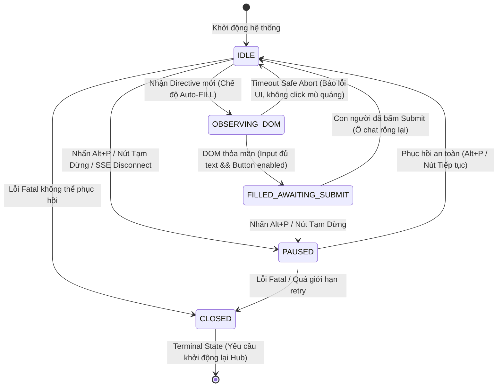

# ĐẶC TẢ KIẾN TRÚC AN TOÀN, MÔ HÌNH TRẠNG THÁI (FSM) & THREAT MODEL BRIDGE HUB
**Tài liệu:** Kiến Trúc An Toàn, Mô Hình Trạng Thái Phân Ranh & Threat Model Realtime Bridge (PE ⟷ THOAN ⟷ AN)  
**Mã tài liệu:** `SPEC-BRIDGE-SEC-001`  
**Phiên bản:** `v1.0.2` (Hiệu đính theo Phán quyết kiểm toán của PE)  
**Căn cứ Base Revision SHA:** `b7ee8b5638878cd3d4548b04a014c712aecf0790`  
**Ngày cập nhật:** 2026-10-12 21:05:00 JST  
**Tác giả:** Kỹ sư thi công AN (Antigravity)  
**Thẩm tra & Phê duyệt:** Kiến trúc sư trưởng / Kiểm toán viên độc lập PE & Minh Chủ THOAN  

---

## I. MỤC TIÊU & NGUYÊN TẮC THIẾT KẾ CỐT LÕI

Hệ thống Realtime Bridge kết nối hai chiều giữa **Perplexity Pro (PE - Claude Sonnet Thinking)** và **Trạm thi công cục bộ (AN - Antigravity)** dưới sự giám sát và giữ cổng quyết định của **Minh Chủ THOAN**.

Nhằm đáp ứng 100% tiêu chuẩn kiểm toán khắt khe của Kiểm toán viên độc lập PE và định hướng của Minh Chủ THOAN, tài liệu phiên bản `v1.0.2` xác lập các nguyên tắc bất biến:
1. **Zero Bot-Evasion Policy:** Tuyệt đối không sử dụng delay ngẫu nhiên, jitter mô phỏng nhịp thở hay bất kỳ kỹ thuật nào nhằm mục đích né tránh cơ chế phát hiện bot của dịch vụ bên thứ ba.
2. **Observable DOM Condition:** Mọi tương tác giao diện chỉ dựa trên các điều kiện DOM quan sát được (Observable State: input đã nạp đầy đủ nội dung, nút Submit đã ở trạng thái `enabled`). Nếu hết timeout mà không thỏa mãn điều kiện thì hủy bỏ an toàn (`Safe Abort`).
3. **Mặc định Giao diện Thật là Assisted / Auto-FILL:** Trên tài khoản Perplexity thật, chế độ mặc định an toàn là **`ASSISTED_AUTO_FILL` (Điền sẵn nội dung, DỪNG LẠI HOÀN TOÀN TRƯỚC NÚT SUBMIT để con người chủ động xem và bấm gửi)**.
4. **Cờ Auto-SUBMIT Khóa Cứng (Hard-Locked):** Cờ `ALLOW_AUTO_SUBMIT_OVERRIDE` bị khóa cứng ở giá trị `false`. Tuyệt đối không kích hoạt Auto-SUBMIT trên môi trường thật trong giai đoạn kiểm toán; việc xem xét mở cờ bắt buộc phải có phê chuẩn riêng bằng văn bản của Kiểm toán viên PE và Minh Chủ THOAN.
5. **Ranh giới Bí mật & Mạng Cực Hạn (Strict Secret & Network Boundary):**
   - `SUPABASE_SERVICE_ROLE_KEY` chỉ tồn tại duy nhất tại Local Hub trên máy trạm (`127.0.0.1`), tuyệt đối không đưa vào Userscript, trình duyệt, clipboard hay log.
   - Loại bỏ hoàn toàn wildcard CORS `*` trong Hub; chỉ cho phép các origin cụ thể (`https://www.perplexity.ai`, `http://127.0.0.1:3956`, `http://127.0.0.1:28888`, `http://localhost:*`).
   - Loại bỏ hoàn toàn wildcard `@connect *` trong Userscript; chỉ giữ lại loopback `127.0.0.1` và `localhost`.
   - Local Hub kiểm tra chặt chẽ `Host` header, từ chối mọi truy cập không xuất phát từ loopback interface.
6. **Chuỗi ACK Trung Thực Phân Ranh 8 Giai Đoạn:** Tách bạch rõ ràng từng chặng từ lưu trữ, truyền tin, thực thi, commit, push đến thẩm định của PE; thất bại ở bất kỳ chặng nào phải ghi nhận `BLOCKED`, tuyệt đối cấm giả lập ACK.
7. **Đồng bộ Phiên bản & Manual Alignment:** Tài liệu `SPEC-BRIDGE-SEC-001 v1.0.2` là chuẩn mực duy nhất có hiệu lực hiện hành. Toàn bộ các mô tả về bộ đếm auto countdown cũ trong các tệp hướng dẫn sơ khởi (`USER_MANUAL.md`, `README.md`) chính thức bị bãi bỏ và đánh dấu là "Legacy / Superseded".

---

## II. PHÂN TÁCH 3 CHIỀU ĐỘC LẬP: MODE, OPERATIONAL STATE & DELIVERY/ACK STATE

Để khắc phục triệt để sự nhập nhèm giữa cấu hình người dùng, trạng thái runtime của hệ thống và vòng đời của từng thông điệp, hệ thống phân định rõ 3 chiều độc lập:

### 1. Chiều 1: User Operating Mode (Chế độ cấu hình do người dùng chọn)

```text
[MANUAL] <===================> [ASSISTED_AUTO_FILL] <===================> [TEST_MODE]
(Thụ động hoàn toàn,          (Mặc định cho web thật,                    (Chỉ dùng cho Mock
 chỉ xem feed/copy)            điền xong dừng trước Submit)               Fixture nội bộ)
```

- **`MANUAL`:** Người dùng điều khiển hoàn toàn bằng tay. Hệ thống chỉ lắng nghe và cập nhật feed tin nhắn, không tự điền vào input, không tự gửi.
- **`ASSISTED_AUTO_FILL`:** Khi nhận Directive hợp lệ từ Hub: tự động điền văn bản vào ô chat, kích hoạt synthetic input events, kiểm tra DOM state và **DỪNG LẠI HOÀN TOÀN TRƯỚC SUBMIT** để con người tự bấm nút gửi.
- **`TEST_MODE`:** Chế độ kiểm thử an toàn, **CHỈ ÁP DỤNG TRÊN MOCK FIXTURE** (`mock_pe_page.html`), payload bắt buộc phải chứa cờ test: `[TEST] Đây là tin nhắn thử nghiệm, không cần thực thi.`

### 2. Chiều 2: Runtime Operational State (Trạng thái vận hành của Userscript / Hub)



- **`IDLE`:** Sẵn sàng nhận thông điệp mới.
- **`OBSERVING_DOM`:** Đang kiểm tra cây DOM theo thuật toán Observable DOM Waiter.
- **`FILLED_AWAITING_SUBMIT`:** Đã điền xong nội dung vào ô chat, hiển thị trạng thái `[ĐÃ ĐIỀN - CHỜ BẤM GỬI]` và dừng chờ người dùng.
- **`PAUSED` (Khả năng phục hồi - Resumable):** Hủy bỏ ngay lập tức mọi pending timer, ngắt các tiến trình dispatch, đóng băng thao tác ghi. Cho phép người dùng đọc feed, copy văn bản và **có thể Resume quay trở lại `IDLE`**.
- **`CLOSED` (Trạng thái kết thúc - Terminal State):** Khi gặp lỗi bảo mật nghiêm trọng (Fatal Security Error / Port Conflict / Unauthorized Origin). Không thể tự resume, yêu cầu đóng phiên an toàn và khởi động lại Hub.

### 3. Chiều 3: Granular Delivery & ACK State (Vòng đời của từng gói tin)

Mỗi thông điệp phải trải qua tuần tự 8 giai đoạn riêng biệt, tuyệt đối không gộp chung:

| Cấp độ | Tên trạng thái (ACK State) | Thực thể xác nhận | Ý nghĩa kiểm toán độc lập |
|---|---|---|---|
| **1** | **`PERSISTED`** | Supabase Cloud | Hàng tin nhắn đã được ghi vào bảng `public.pe_bridge` và được cấp ID duy nhất cùng timestamp. |
| **2** | **`INBOX_WRITTEN`** | Local Hub | Hub đã đọc hàng, kiểm tra tính hợp lệ (thread, sender, anti-replay) và ghi an toàn vào file inbox `.agents/PE_INBOX_LATEST.json`. |
| **3** | **`WATCHER_SEEN`** | Watcher Process | Tiến trình `watch_directive.py` phát hiện file inbox thay đổi, băm SHA256 khớp với nội dung hàng và tạo lock file. |
| **4** | **`AN_ACKNOWLEDGED`** | Kỹ sư AN | Agent AN nạp nội dung chỉ thị vào ngữ cảnh phiên làm việc và xác nhận phạm vi thi công. |
| **5** | **`TASK_COMPLETED`** | Kỹ sư AN | AN hoàn thành việc sửa đổi mã nguồn/học liệu và vượt qua toàn bộ các bài test cục bộ. |
| **6** | **`GIT_COMMITTED`** | Local Git Repo | Mã nguồn đã được commit vào Git repo cục bộ trên nhánh `rebuild/v3` với Commit SHA cụ thể. |
| **7** | **`GIT_PUSHED`** | GitHub Remote | Commit đã được push thành công lên `origin/rebuild/v3` và sẵn sàng cho PE đối soát qua connector. |
| **8** | **`PE_VERDICT_ISSUED`** | Kiểm toán viên PE | PE truy cập GitHub đối soát 7 Tiêu chuẩn C1–C7 và ban hành phán quyết chính thức (`APPROVE` / `REVISE`). |
| **ERR** | **`BLOCKED`** | Bất kỳ thành phần nào | Khi gặp lỗi ở bất kỳ chặng nào (sai thread, lỗi RPC, sandbox block, test fail), hệ thống **BẮT BUỘC ghi nhận `BLOCKED` tại đúng chặng đó**; tuyệt đối cấm tạo ACK giả. |

---

## III. THUẬT TOÁN OBSERVABLE DOM WAITER (XÁC ĐỊNH & KHÔNG DELAY MÙ QUÁNG)

```text
[BƯỚC 1] Nhận Directive Payload từ Local Hub qua SSE.
   │
   ▼
[BƯỚC 2] Tìm phần tử Input: textarea hoặc [contenteditable="true"]
   ├── Nếu KHÔNG TÌM THẤY sau 3000ms: Ghi log "DOM_INPUT_NOT_FOUND" ──> ABORT (Chuyển MANUAL)
   └── Nếu TÌM THẤY: Gán giá trị và phát chuỗi sự kiện mô phỏng (input, change, keydown).
   │
   ▼
[BƯỚC 3] Vòng lặp quan sát điều kiện DOM (Observable Condition Loop - Polling 50-100ms, Timeout 5000ms):
   Kiểm tra đồng thời 2 điều kiện quan sát được:
   ├── (1) inputElement.value === expectedPayloadText
   └── (2) submitButton !== null VÀ submitButton.disabled === false VÀ submitButton.getAttribute('aria-disabled') !== 'true'
   │
   ├── [TRƯỜNG HỢP A: THỎA MÃN ĐỦ 2 ĐIỀU KIỆN TRONG 5000ms]
   │    └── Ở chế độ ASSISTED_AUTO_FILL:
   │         ├── DỪNG LẠI HOÀN TOÀN TRƯỚC SUBMIT.
   │         └── Cập nhật giao diện thanh Bridge: "ĐÃ ĐIỀN NỘI DUNG - CHỜ NGƯỜI DÙNG BẤM GỬI" (Màu xanh lục).
   │
   └── [TRƯỜNG HỢP B: QUÁ TIMEOUT 5000ms KHÔNG THỎA MÃN]
        └── Ghi log "DOM_TIMEOUT_SAFE_ABORT" ──> DỪNG AN TOÀN, không click mù quáng, báo lỗi lên UI.
```

---

## IV. THREAT MODEL & THU HẸP RANH GIỚI BẢO MẬT MẠNG

### 1. Thu Hẹp CORS & Khóa Cứng Loopback Interface
- **Loại bỏ hoàn toàn wildcard:** Local Hub không sử dụng wildcard `*` cho CORS. Danh sách origin được phép:
  ```javascript
  const STRICT_ALLOWED_ORIGINS = [
      'https://www.perplexity.ai',
      'http://127.0.0.1:3956',
      'http://127.0.0.1:3957',
      'http://127.0.0.1:28888',
      'http://localhost:3956',
      'http://localhost:3957',
      'http://localhost:28888'
  ];
  ```
- **Kiểm tra Host Header chống Loopback Bypass:** Local Hub kiểm tra header `Host` trên mọi HTTP request; từ chối (HTTP 403 `FORBIDDEN_HOST`) nếu request không xuất phát từ `127.0.0.1` hoặc `localhost`.
- **Userscript `@connect`:** Đã loại bỏ hoàn toàn `// @connect *`, chỉ giữ lại:
  ```javascript
  // @connect      127.0.0.1
  // @connect      localhost
  ```

### 2. Ma Trận Quyền Hạn Chi Tiết

| Thực thể (Component) | Vị trí thực thi | Quyền đọc (Read) | Quyền ghi (Write) | Bí mật nắm giữ (Secrets Held) | Ranh giới an toàn (Security Boundaries) |
|---|---|---|---|---|---|
| **Supabase `pe_bridge`** | Supabase Cloud | Bị kiểm soát bởi RLS | Bị kiểm soát bởi RLS / Service-role | JWT Secret (Server-side) | Không chấp nhận payload sai schema; chặn DDL ad-hoc. |
| **Local Hub** (`omni_realtime_hub.cjs`) | Node.js (`127.0.0.1:3956+`) | Đọc Supabase, đọc inbox ledger | Ghi Supabase (status), ghi inbox file | **`SUPABASE_SERVICE_ROLE_KEY`** (Trong file `.env` cục bộ) | **Bind duy nhất vào `127.0.0.1`**, cấm bind `0.0.0.0`. CORS whitelist cụ thể; Host header validation. |
| **Userscript** (`omni_pe_bridge.user.js`) | Trình duyệt Client (Tampermonkey) | Đọc SSE từ Local Hub, đọc DOM Perplexity | Ghi DOM Perplexity (chỉ input text), gửi Event về Local Hub | **ZERO SECRET** (Không có bất kỳ API key nào) | Không truy cập database trực tiếp; không xuất key ra clipboard/log; chế độ web thật chỉ Auto-FILL; `@connect` chỉ loopback. |
| **Watcher** (`watch_directive.py`) | Python (Local Workspace) | Đọc file `.agents/PE_INBOX_LATEST.json` | Cập nhật file ACK ledger cục bộ | Không có secret | Kiểm tra file lock chống race-condition; phát hiện directive mới. |
| **Agent AN** (Antigravity CLI/IDE) | Local Subagent System | Đọc chỉ thị từ inbox file / context | Thực thi code cục bộ, commit Git, chạy script test | Local repo permissions | Tuân thủ 100% ranh giới: `src/` net change = 0; không sửa DB production; không merge `main`. |

---

## V. ĐỊNH DANH PHẠM VI PROMPT VAULT

- **Bản chất kỹ thuật:** Tệp `tools/realtime-bridge/data/prompt_vault.json` là một **Kho Lưu Trữ Cấu Trúc Cục Bộ (Local Structured Cache / Vault)** trên máy trạm cá nhân của người dùng.
- **Phạm vi áp dụng:** Lưu giữ các mẫu prompt chuẩn phục vụ điền nhanh; quản lý cục bộ với cơ chế sao lưu `.bak` và kiểm tra tính toàn vẹn JSON; **khẳng định không phải là database đồng bộ đa máy**.

---

## VI. KHÓA CỨNG CỜ TÍNH NĂNG AUTO-SUBMIT (HARD-LOCKED FEATURE FLAG)

1. Cờ điều khiển trong Userscript được cấu hình khóa cứng:
   ```javascript
   const BRIDGE_CONFIG = {
       MODE: "ASSISTED_AUTO_FILL", // Mặc định an toàn kiểm toán theo chỉ thị PE
       ALLOW_AUTO_SUBMIT_OVERRIDE: false // HARD-LOCKED: Khóa cứng, tuyệt đối không bật trong kiểm toán
   };
   ```
2. **Quy định pháp lý kỹ thuật:** Việc bật cờ này trong tương lai bắt buộc phải có phê chuẩn độc lập bằng văn bản của Kiểm toán viên PE và sự đồng thuận của Minh Chủ THOAN sau khi toàn bộ quy trình kiểm toán an toàn hoàn tất.
